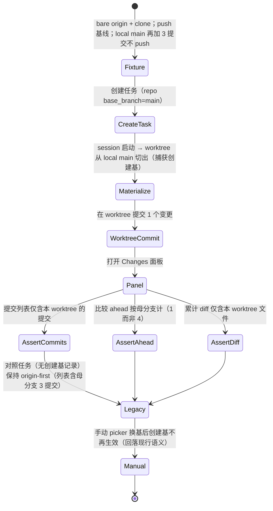

# Tasks: anchor-worktree-comparison-base

## Verification Strategy

| 问题 | 回答 |
|------|------|
| **验证类型** | `integration-test`（Go 侧 agentctl `process`/`api` 集成矩阵为准入核心）+ Playwright e2e 两支 spec 作为 UI 层准出 |
| **选择理由** | 测试对象是具体程序代码（比较解析、物化捕获、投影优先级、面板展示）。行为矩阵（母分支领先/推进/改写/删除、分叉点丢失、优先级、存量兼容）在 Go 集成层可全量、快速、确定性覆盖；「用户在 Changes 面板看到什么」只有 e2e 能证明，故 UI 准出用 Playwright（desktop + mobile parity，仓库规范） |
| **验证入口** | Go：`make -C apps/backend test`（聚焦包：`go test ./internal/agentctl/server/process/... ./internal/agentctl/server/api/... ./internal/task/... ./internal/agent/runtime/lifecycle/... ./internal/worktree/...`）；e2e：`cd apps/web && pnpm e2e:run --host --no-build --project chromium -- e2e/tests/git/worktree-creation-base-comparison.spec.ts` 与 `--project mobile-chrome -- e2e/tests/git/mobile-worktree-creation-base-comparison.spec.ts` |
| **probe 证据** | 全部设计未知已在 plan 阶段用代码级勘探关闭（design.md Research Log 六条，含 file:line）：载体选 tracker map、sticky marker 已存在、捕获点 `createNewBranchRef` 已解析分叉点 OID、优先级插入点先查显式 target、前端显示位、无外部依赖 |
| **未验证假设** | 无硬 blocker。一个软假设：`runGitCumulativeDiffForRepoResolved` 的内部结构与 `runGitLogForRepo` 同构（handoff 在 main 复核过 `git.go:1151`「matches the COMMITS panel」注释；apply 阶段 Task 5 实施时先读该函数再插入，若结构不同按 D5 的同一算法契约插入） |

## E2E 测试图

### 节点说明

| 节点 | 状态描述 | 断言 |
|------|---------|------|
| Fixture | `origin/main` 落后 local `main` 3 个提交 | `git rev-list --count origin/main..main` = 3 |
| Materialize | worktree 分支从 local main 切出 | `task_repositories.metadata.creation_base` 记录 `{ref: "main", fork_sha: <local main tip>}`（经 WS/DB 侧效应可见于面板行为） |
| AssertCommits | commits 列表 | 仅 1 条（worktree 提交），不含母分支 3 提交 |
| AssertAhead | ahead 计数 | = 1（vs 母分支），而非 4（vs origin/main） |
| AssertDiff | 累计 diff | 仅 worktree 变更文件 |
| Legacy | 存量任务（物化于变更前 / 无记录） | 列表混入母分支提交（现行行为不变），picker 逃生口可用 |
| Manual | picker 手动选基 | 创建基不再生效，回落所选分支的现行解析 |

### 核心覆盖路径

1. **路径 1（成功，症状复现反转）**：Fixture → CreateTask → Materialize → WorktreeCommit → Panel → 三断言。这是「推送 39」用户实测场景的最小复现与修复证明。
2. **路径 2（存量兼容）**：无创建基记录的任务面板行为与变更前一致。
3. **路径 3（手动覆盖）**：picker 换基后创建基失效（marker sticky）。
4. **Go 集成矩阵补充路径**（不进 e2e，在 `process`/`api` 包测试）：母分支推进后切出（锚稳定）、worktree rebase 到新母 tip（范围收缩）、母分支删除（分叉点锚）、分叉点 SHA 丢失（unavailable 错误码）、显式 fork-PR target 共存（target 胜出）。

## 实现清单

> 按 1 → 9 顺序推进，每条完成即勾选。Task 2 依赖 1；3 依赖 1；4 依赖 1（类型）；5 依赖 4；6 依赖 3+4；7 依赖 5 的 DTO 字段；8 依赖全部；9 在行为定稿后。每条 task 先写聚焦失败测试（TDD），记录红/绿命令到 ledger。

### 1. 领域模型与 metadata 持久化

- [x] 1.1 新建 `apps/backend/internal/task/models/creation_base.go`：`CreationBase{Version int, Ref string, ForkSHA string}`（`CreationBaseVersion = 1`，metadata key `CreationBaseMetadataKey = "creation_base"`）；`Validate()`（Version 匹配、Ref 非空且过 ref 安全校验——复用 `service_branch_update.go` 的 `isSafeBaseBranchRef` 同源规则或 `securityutil.IsValidBranchName` 放宽允许 `origin/` 前缀、ForkSHA 为 40/64 位 hex）；`PutCreationBase` / `LoadCreationBase` / `RemoveCreationBase`（镜像 `comparison_target.go:228-272` 的 merge-preserving 三件套，含 `loadValidatedMetadata` 复用）。
  - 测试：`creation_base_test.go` 覆盖合法往返、未知 Version 拒绝、危险 ref 拒绝（`..`、lock 后缀、空）、坏 hex SHA 拒绝、保留无关 metadata key、Remove 幂等。
  - 准出：`go test ./internal/task/models/ -run CreationBase -v` 绿。
- [x] 1.2 repo 层写入口：`internal/task/repository/sqlite/` 增 merge-preserving 更新方法 `UpdateTaskRepositoryCreationBase(ctx, taskRepositoryID string, cb *models.CreationBase) error`（读行 → `PutCreationBase` → 只写 metadata 列；镜像 comparison-target 的窄 mutation 模式），并在 repository 接口暴露。
  - 测试：sqlite repo 测试覆盖写-读往返、不存在行报 `ErrTaskRepositoryNotFound`、并发无关 key 保留。
  - 准出：`go test ./internal/task/repository/sqlite/ -run CreationBase -v` 绿。

### 2. 物化捕获（worktree manager → executor 持久化）

- [x] 2.1 `internal/worktree/manager_lifecycle.go`：`newBranchAddSnapshot` 增 `baseRef string`；`createNewBranchRef` 把传入 `baseRef` 与已解析 `oid` 一并填入 snapshot 并随 `Worktree` 返回（`Worktree` 增 `CreationBaseRef` / `CreationForkSHA` 字段，`worktree.go`；仅 `createNewBranchRef` 新建分支路径填充，`tryReuseExisting` 复用路径不填）。
  - 测试：worktree manager 测试（现有 fixture）断言新建分支的 Worktree 带母 ref + tip OID、复用路径不带。
  - 准出：`go test ./internal/worktree/ -run CreationBase -v` 绿。
- [x] 2.2 `internal/agent/runtime/lifecycle/env_preparer.go:267` `RepoWorktreeResult` 增 `CreationBaseRef` / `CreationForkSHA`；`env_preparer_worktree.go:514` 从 Worktree 填充；`internal/orchestrator/executor/executor_execute.go`（`buildTaskEnvironmentRepos:3942` 持久化点旁）对每个带创建基的 result 调 `UpdateTaskRepositoryCreationBase`（失败记 warn 不阻断物化——记录是增强不是前置条件）。
  - 测试：executor 集成测试断言物化后 `task_repositories.metadata.creation_base` 落盘且 ref = base ref 原样、sha = 切出点。
  - 准出：`go test ./internal/orchestrator/executor/ -run CreationBase -v` 绿。

### 3. task service 投影与 live 更新

- [x] 3.1 新建 `internal/task/service/service_creation_base_projection.go`（镜像 `service_comparison_target_projection.go`）：`collectTaskCreationBases(ctx, taskID) (map[string]models.CreationBase, error)`——键与 comparison targets 相同的 repo subpath 约定；**逐行跳过**带 `comparison_target` 或 `manual_base_branch_override` 的行（D3 优先级裁决点）；`TaskCreationBases` 导出 + `PushCreationBasesForTask` 接口字段（`service.go:248` 旁）。
- [x] 3.2 `service_branch_update.go:153-179` `applyBaseBranchSideEffects` 末尾追加创建基推送（`s.creationBasePusher.PushCreationBasesForTask`，best-effort warn，照既有两推送）。
  - 测试：service 测试——手动选择后 collect 跳过该行；带 comparison_target 的行跳过；普通行进入 map。
  - 准出：`go test ./internal/task/service/ -run CreationBase -v` 绿。

### 4. agentctl 传输管道（config / instance / 控制路由）

- [x] 4.1 `internal/agentctl/server/config/config.go`：`InstanceConfig` 增 `CreationBases map[string]models.CreationBase`（镜像 `ComparisonTargets:372-375` 与 `cloneComparisonTargets:829` 的 clone）；`internal/agentctl/server/instance/instance.go:229` 旁增 `creation_bases` 请求字段；`instance/manager.go:305,384` 传递。
- [x] 4.2 `internal/agentctl/server/process/manager.go`：增 `UpdateCreationBases(ctx, map[string]models.CreationBase)`（照 `UpdateBaseBranches:1272` —— 替换 map、stamp 全部 tracker（root/repos/subpath，照 `lookupBaseBranch` 加 `lookupCreationBase`）、后台 refresh）；tracker spawn 点 `manager_submodules.go:88` 旁 stamp。
- [x] 4.3 控制路由：`api/server.go:171` 旁注册 `POST /workspace/creation-bases`，新建 `api/workspace_creation_bases.go`（镜像 `workspace_comparison_targets.go`，校验 + 调 `UpdateCreationBases`）；lifecycle 的 agentctl client（`internal/agent/runtime/agentctl/`）增 `SetCreationBases` 方法（镜像 `SetComparisonTargets`）。
  - 测试：api 路由测试（合法/非法 payload、鉴权照既有内部控制路由模式）；process manager 测试（map 替换、tracker stamp、subpath 键）。
  - 准出：`go test ./internal/agentctl/server/api/ ./internal/agentctl/server/process/ -run CreationBase -v` 绿。

### 5. agentctl 比较解析（核心）

- [ ] 5.1 新建 `internal/agentctl/server/process/creation_base.go`：`WorkspaceTracker.SetCreationBase(*models.CreationBase)`（mutex 下替换，`ComparisonResolution` 快照风格）+ `CreationBaseResolution()` 快照 + `ResolveCreationBaseAnchor(ctx) (sha string, err code)` 按 design D5 算法：`merge-base(HEAD, Ref)` 原样解析；Ref 不可解析或 merge-base 严格落后 ForkSHA（`IsAncestor(mb, Fork) && mb != Fork`）→ `ForkSHA`；最终 anchor 不可解析 → 有界错误码 `creation_base_ref_unavailable`；不调用 `CorrectStaleComparisonBase`。常量 `creationBaseErrorRefUnavailable`。
- [ ] 5.2 三个插入点（都插在显式 comparison target 之后、branch-only 之前）：
  - `workspace_git_status.go` base 解析（:468/:703 优先级层之下）：创建基存在 → `computeBaseCommit`/`ResolveBaseAnchor` 用 `ResolveCreationBaseAnchor`；状态载荷增创建基 display（母 ref 名）与错误码字段（镜像 ComparisonStatus/ComparisonErrorCode 的 DTO 路径到 `types.GitStatusUpdate`）。
  - `git.go:875-950` `runGitLogForRepo`：`comparison.Explicit` 分支后查 tracker 创建基 → 命中则 baseCommit = anchor（跳过 req.TargetBranch 路径与 stale 重锚）。
  - `git.go` `runGitCumulativeDiffForRepoResolved`（~:1151）：同上插入（实施前先读该函数，同构则镜像插入）。
  - 测试（`process` + `api` 包，D5 全矩阵）：本地 main 领先 origin（只含本 worktree 提交）；母分支推进后切出（锚=分叉点不变）；worktree rebase 到新母 tip（范围收缩）；母分支删除（ForkSHA 锚）；母分支改写 merge-base 落后（ForkSHA 锚）；ForkSHA 丢失（unavailable 错误码、文件状态面不受影响）；显式 comparison target 共存时 target 胜出；无创建基（现行 origin-first 不变）；Ref 含 `origin/` 前缀（remote-only base）原样解析。
  - 准出：`go test ./internal/agentctl/server/process/ ./internal/agentctl/server/api/ -run "CreationBase|ComparisonBase" -v` 绿。

### 6. lifecycle 接线（seed / readiness / live push）

- [x] 6.1 新建 `internal/agent/runtime/lifecycle/manager_creation_base.go`（镜像 `manager_comparison_targets.go`）：`CreationBaseProvider` 类型 + `SetCreationBaseProvider` + `seedExecutionCreationBases` + `pushTaskCreationBases` + `PushCreationBasesForTask`；`executor_backend.go:214` 旁 `MetadataKeyCreationBases = "creation_bases"`；`manager_launch.go:1390-1396` 旁 collect + seed。
- [x] 6.2 backendapp 装配：provider 注入（task service 的 `TaskCreationBases`）+ `SetCreationBasePusher`（照 comparisonTargetPusher 接线点）。
  - 测试：lifecycle 测试（seed 进 metadata、readiness 推送、live 更新走 `SetCreationBases`、空 map 不推送——照 `pushTaskBaseBranches` 的空保护注释）。
  - 准出：`go test ./internal/agent/runtime/lifecycle/ -run CreationBase -v` 绿。

### 7. 前端展示与 i18n

- [x] 7.1 web 状态类型与头部展示：跟随 `ComparisonStatus`/`ComparisonDisplay` 的既有字段路径（`grep -rn "comparisonStatus\|comparison_status" apps/web/src apps/web/hooks apps/web/lib` 定位类型与消费点）把创建基 display/错误码加进 web 类型；`apps/web/components/task/changes-panel-header-actions.tsx:220-287` 的 `baseBranchDisplay`/`ComparisonTargetDisplay` 渲染区显示生效比较基（母 ref 名）；unavailable 时显示既有 unavailable 指示模式（照 comparison target 失败态）。
- [x] 7.2 i18n：新增 copy 进 7 语言目录（`apps/web/src/locales/`），繁体用 `pnpm run i18n:zh-hant`；无 em dash；`t()` 包裹。
  - 测试：组件测试（创建基 display 渲染、unavailable 态）；`pnpm run i18n:check` + `pnpm run i18n:ratchet` 绿。
  - 准出：`cd apps/web && pnpm run typecheck && pnpm run lint && pnpm run i18n:check` 绿。

### 8. E2E（desktop + mobile parity）

- [x] 8.1 新建 `apps/web/e2e/tests/git/worktree-creation-base-comparison.spec.ts` + `mobile-worktree-creation-base-comparison.spec.ts` + 共享 helpers（fixture：bare origin + clone + push 基线 + local main 领先 3 提交不 push；参照 `fork-pr-comparison-target-helpers.ts` 的仓库准备模式与 `local-base-operations-helpers.ts` 的本地分支操作模式）。断言 E2E 测试图三断言 + 存量对照（路径 2）+ 手动覆盖（路径 3，picker 换基后回落）。
  - 准出：两支 spec 在 chromium 与 mobile-chrome 项目下通过。

### 9. durable spec、ADR、公开文档

- [x] 9.1 ADR：`docs/decisions/` 新增（英文，走 `/record` 约定）：反转 worktree 任务工作区比较默认基为创建基；引用被反转的 origin-first 设计（`git.go:831-845` 注释）与 fork-pr-comparison-targets 的 invariants 保留。
- [x] 9.2 durable spec：`docs/specs/platform/requirements/workspace-git-status.md` 增创建基 ACs（对齐 spec delta 的 6 Requirement）；`docs/specs/platform/system-design/workspace-git-status.md` 增设计段（载体、优先级、回退算法、错误码）。校验：`uv run --no-project --python 3.12 python scripts/list-docs.py validate` 与 `uv run --no-project --python 3.12 python scripts/lint-spec-files.py --all`。
- [x] 9.3 文档：`docs/git-operations.md`、`docs/public/git-operations.md`（比较基语义与「更改面板默认对本 worktree 工作」）、`docs/public/coordination.md`（子任务基线叙述补创建基口径）；走 `/docs-maintainer` 评估清单。

## 验证清单

- [x] `make -C apps/backend test` 全绿；`bash scripts/lint-go-changed <changed-go-files>` 无新违规。
- [x] `cd apps && pnpm --filter @kandev/web typecheck && pnpm --filter @kandev/web lint`；`cd apps/web && pnpm run i18n:check && pnpm run i18n:ratchet`。
- [x] e2e 两支 spec（chromium + mobile-chrome）通过；`node scripts/validate-public-docs.mjs` 通过（若 9.3 改动公开文档）。
- [x] `openspec validate anchor-worktree-comparison-base --strict --no-interactive` 通过。
- [x] durable spec 校验（9.2 两条命令）通过。
- [x] 自查 spec delta 的 6 个 Requirement / 13 个 Scenario 逐条映射到测试（Go 矩阵或 e2e），无缺口。

## 状态恢复要求（apply 阶段）

- 按 1 → 9 顺序推进；每条 task 独立可测、可提交（Conventional Commits，gofmt/prettier 钩子注意 re-stage）。中断后从第一个未勾选 task 继续：Task 1-3 是后端数据面（无行为变化，可独立合入）；Task 4-5 是行为核心；Task 6 接通 live；Task 7-8 是 UI 与 e2e；Task 9 是文档定稿。Task 5 实施前先读 `runGitCumulativeDiffForRepoResolved` 确认同构插入（软假设，见 Verification Strategy）。
- 全部完成后进入 verify（`openspec-verify-change`）与 archive（`openspec-archive-change`），不在本阶段勾选 spec delta 或提前归档。
