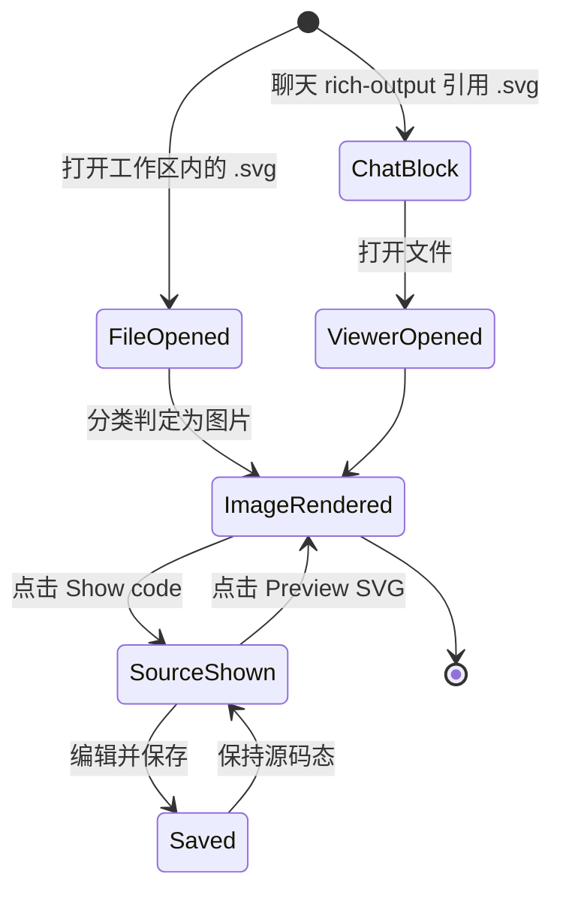

# Tasks: add-svg-file-preview

## Verification Strategy

| 问题 | 回答 |
|------|------|
| **验证类型** | `e2e-script` |
| **选择理由** | 本 change 的两个核心风险只有真实浏览器能证伪：其一，SVG 能否经 `` + `data:` URL 真正渲染出图，这依赖渲染管线与桌面外壳 CSP 的相互作用，而 jsdom 不实现图片解码与布局，单测无法证明「图出来了」；其二，工具栏由二元分支改描述符后，既有 markdown / html 预览按钮是否被打坏，需要在真实交互下回归。此外移动端 44px 触控与「无横向溢出」属布局行为，同样只有浏览器可验。单测在本 change 中用于覆盖纯函数判定与编码（过程手段），**不作为唯一验收依据**。 |
| **验证入口** | 桌面：`cd apps/web && pnpm e2e:run -- tests/task/svg-file-preview.spec.ts` 移动端：`cd apps/web && pnpm e2e:run --project mobile-chrome -- tests/task/mobile-file-viewer.spec.ts` 单测：`cd apps/web && pnpm test -- file-types`（及对应组件/hook 用例） |
| **probe 证据** | 见 `design.md` 的 `## Research Log`。要点：`setupMobileFileViewerTest` 已支持 `options.extension` / `options.content`（`apps/web/e2e/tests/task/mobile-file-viewer.spec.ts:20-70`），`GitHelper.createFile` 接受 `string \| Buffer`（`apps/web/e2e/helpers/git-helper.ts:32`），无需新建 fixture 基建；`mobile-` 文件名前缀选择 mobile-chrome project（同文件头部注释）；`assertNoDocumentHorizontalOverflow` 可直接支撑溢出断言（`apps/web/e2e/helpers/layout-assertions.ts`）；SVG 经 `` 渲染的运行时可行性已由既有 CI 断言覆盖（`apps/web/e2e/tests/chat/html-preview.spec.ts:11-12` 及同文件 `image.naturalWidth > 0`）。 |
| **未验证假设** | N/A。依赖准出门禁已全部落到「試通證據」，无 blocker、无未验证假设。 |

## E2E 测试图

### 节点说明

| 节点 | 状态描述 | 断言 |
|------|---------|------|
| FileOpened | `.svg` 已在文件查看器打开 | 未落到源码编辑器；工具栏/查看器已就绪 |
| ImageRendered | 图形已渲染 | `image-viewer` 可见，且 `naturalWidth > 0`（证明真的解码成功，而非碎图占位） |
| SourceShown | 处于源码态 | 源码编辑器可见，且存在可回到图形的动作 |
| Saved | 源码编辑已保存 | 脏标记清除，重新读取内容一致 |
| ChatBlock | 聊天 rich-output 块呈现该 SVG | 块内 `img` 可见，而非截断的 `<pre>` 文本 |
| ViewerOpened | 由聊天块跳转到完整查看器 | 查看器打开同一路径的文件并呈现图形 |

### 核心覆盖路径

1. **路径 1（桌面主路径）**：FileOpened → ImageRendered → SourceShown → ImageRendered — 打开 SVG 默认即见图，可切源码并切回。
2. **路径 2（编辑往返）**：ImageRendered → SourceShown → Saved — 源码态保留编辑与保存能力。
3. **路径 3（移动端）**：FileOpened → ImageRendered → SourceShown — 同一能力在 coarse-pointer 下成立，`Show code` 触控尺寸 ≥ 44px，且文档无横向溢出。
4. **路径 4（聊天块）**：ChatBlock → ViewerOpened → ImageRendered — 聊天内 SVG 按同一规则呈现，源码入口经既有打开文件动作到达。
5. **回归路径 A**：既有 markdown / html 预览按钮行为不变（`markdown-preview-toggle`、`html-preview-toggle`）。
6. **不回归路径 B**：名为 `.png` 但内容为 UTF-8 文本的文件仍进入源码编辑器。

## 实现清单

### 1. 分类与渲染基元

- [x] 1.1 新增 `TEXT_IMAGE_EXTENSIONS`（当前仅 `svg`）与 `isTextEncodedImage(path)` (`apps/web/lib/utils/file-types.ts`)
- [x] 1.2 新增导出 `resolveFileViewerKind(path, isBinary)`，实现 D1 的三条分支：图片扩展名且（二进制 或 文本编码图片格式）→ `image`；二进制 → `binary`；其余 → `text` (`apps/web/lib/utils/file-types.ts`)
- [x] 1.3 新增 `utf8ToBase64(text)`，用 `TextEncoder` 后按 `0x8000` 分块 `String.fromCharCode` 再 `btoa`，避免大输入触发调用栈溢出 (`apps/web/lib/utils/file-types.ts`)
- [x] 1.4 新增 `buildImageSrc(path, content, isBinary)`：二进制直用后端 base64，文本先 `utf8ToBase64`，两者拼成同一 `data:${mime};base64,` 形态 (`apps/web/lib/utils/file-types.ts`)
- [x] 1.5 单测补全 (`apps/web/lib/utils/file-types.test.ts`)：`svg` 文本 → `image`；`.png` 文本 → `text`（不回归）；`.png` 二进制 → `image`；`.zip` → `binary`；多字节 UTF-8（含中文）base64 往返正确；超过单块阈值的内容编码正确；既有 markdown / html `previewKind` 用例保持不变

**准出**：`cd apps/web && pnpm test -- file-types` 全绿；四个既有 `previewKind` 断言未改动。

### 2. 图片查看器

- [x] 2.1 接受 `isBinary` prop 并改用 `buildImageSrc` 生成 `src` (`apps/web/components/task/file-image-viewer.tsx`)
- [x] 2.2 新增可选 `onShowSource` 动作，仅在传入时渲染 `Show code`（复用现有 header 动作位），带独立 `data-testid` (`apps/web/components/task/file-image-viewer.tsx`)
- [x] 2.3 给 `` 补 `data-testid="image-viewer"`，供 E2E 断言渲染成功 (`apps/web/components/task/file-image-viewer.tsx`)
- [x] 2.4 新建单测：二进制内容原样进 `src`；文本 SVG 经编码后进 `src`；未传 `onShowSource` 时不渲染该按钮 (`apps/web/components/task/file-image-viewer.test.tsx`，新建)

**准出**：新单测全绿；`apps/web/components/task/file-editor-panel.image.test.tsx` 不回归。

### 3. 源码切换 hook

- [x] 3.1 新增 `useTextImageSourceToggle(fileIdentity, isBinary, path)`，暴露 `enabled` / `showSource` / `showSourceCode` / `showImage`，并在 `fileIdentity` 变化时重置为图形态 (`apps/web/hooks/use-text-image-source-toggle.ts`)
- [x] 3.2 新建单测：切换生效；`fileIdentity` 变化后回到图形态；非文本编码图片格式时 `enabled` 为 false (`apps/web/hooks/use-text-image-source-toggle.test.ts`，新建)

**准出**：hook 单测全绿；三个宿主可共用同一实现。

### 4. 工具栏回切入口

- [x] 4.1 把 `PreviewButton` 的 `isHtml ? A : B` 二元分支改为动作描述符查找表，新增可选 `sourcePreviewAction` prop 并保证 markdown / html 两路标签、testid、禁用态与信任提示完全等价 (`apps/web/components/editors/monaco/monaco-editor-toolbar.tsx`)
- [x] 4.2 同构改动 CodeMirror 侧工具栏 (`apps/web/components/editors/codemirror/codemirror-code-editor.tsx`)
- [x] 4.3 增加 `sourcePreviewAction` 透传链路：`FileEditorContent` → 编辑器组件 → 工具栏 (`apps/web/components/task/file-editor-content.tsx`)
- [x] 4.4 测试：`markdown-preview-toggle` / `html-preview-toggle` 的渲染条件与标签不变；传入 `sourcePreviewAction` 时出现新 testid (`apps/web/components/editors/monaco/monaco-editor-toolbar.test.tsx`)

**准出**：两个工具栏测试全绿；`previewKind === "none"` 时仍不显示预览按钮（除非显式传入 `sourcePreviewAction`）。

### 5. 三个查看器宿主接线

- [x] 5.1 用 `resolveFileViewerKind` 替换本地判定，接 `useTextImageSourceToggle`，在图形/源码两态间切换，源码态透传 `sourcePreviewAction` (`apps/web/components/task/file-tab-content.tsx`)
- [x] 5.2 同上；`ImagePanel` 需从 dockview store 一并取出 `isBinary` 传给查看器 (`apps/web/components/task/file-editor-panel.tsx`)
- [x] 5.3 同上，并确保 `Show code` 在 coarse-pointer 下触控尺寸 ≥ 44px、图形容器不产生文档级横向溢出 (`apps/web/components/task/mobile/mobile-file-viewer-panel.tsx`)
- [x] 5.4 组件测试覆盖三处的「默认图形 / 切到源码」两态 (`apps/web/components/task/file-tab-content.test.tsx`、`apps/web/components/task/mobile/mobile-file-viewer-panel.test.tsx`)

**准出**：三处共用同一判定函数与同一 hook，无重复实现残留；组件测试全绿。

### 6. 聊天 rich-output 文件块

- [x] 6.1 把「是否图片」判定提到 `is_binary` 之前，并用 `buildImageSrc` 生成 `src`；非图片二进制维持既有「预览不可用」文案，文本维持截断 `<pre>` (`apps/web/components/task/chat/messages/kandev/rich-output/file-preview-block.tsx`)
- [x] 6.2 新建测试：SVG 引用渲染 `img`；非图片二进制文案不变；文本仍走 `<pre>` (`apps/web/components/task/chat/messages/kandev/rich-output/file-preview-block.test.tsx`，新建)

**准出**：三个分支各有断言；不改动该块的展开/折叠行为。

### 7. 本地化

- [x] 7.1 新增 `editors:previewSvg` 到 `en` / `pt-pt` / `zh-cn` (`apps/web/src/locales/{en,pt-pt,zh-cn}/editors.json`)
- [x] 7.2 运行 `cd apps/web && pnpm run i18n:zh-hant` 生成 `zh-hk` / `zh-tw`，不手工翻译
- [x] 7.3 复用既有 `task:showCode`（五个 locale 已在，无需新增），确认无 U+2014

**准出**：`cd apps/web && pnpm run i18n:check` 全绿。

### 8. E2E

- [x] 8.1 新建桌面 spec：用 `GitHelper` 写入 `.svg` 与一个内容为文本的 `.png`，断言默认渲染（`image-viewer` 可见且 `naturalWidth > 0`）、切源码、切回、编辑保存，以及 `.png` 文本文件仍进编辑器 (`apps/web/e2e/tests/task/svg-file-preview.spec.ts`)
- [x] 8.2 扩展既有移动端 spec：用其 `setupMobileFileViewerTest({ extension: "svg", content })` 覆盖渲染与源码切换，并用 `assertNoDocumentHorizontalOverflow` 断言行溢出，确认 `Show code` 触控尺寸 (`apps/web/e2e/tests/task/mobile-file-viewer.spec.ts`)

**准出**：两个 spec 在对应 project 下全绿；等待使用 `e2e/helpers/causal-waits.ts` 的既有原语，不新增未登记的 sleep。

### 9. 规格文档

- [x] 9.1 新增与 `native-html-preview` 并列的 requirements 与 system-design 一对，覆盖判定规则、渲染形态与 CSP 约束、四入口一致性、non-goals (`docs/specs/ui/requirements/svg-file-preview.md`、`docs/specs/ui/system-design/svg-file-preview.md`)
- [x] 9.2 运行 `python3 scripts/lint-spec-files.py --all`

**准出**：spec lint 通过；文档与 `openspec/changes/add-svg-file-preview/specs/file-preview/spec.md` 语义一致。

### 10. 收尾

- [x] 10.1 运行 `cd apps/web && pnpm lint` 与 `cd apps/web && pnpm typecheck`
- [x] 10.2 按仓库约定用 `/mobile-parity` 复核移动端交互与触控尺寸

**准出**：lint 与 typecheck 全绿；移动端复核无待办。

## 验证清单

- [x] 路径 1：桌面打开 `.svg` → 立即渲染图形 → `Show code` → 源码 → `Preview SVG` → 图形再现
- [x] 路径 2：源码态编辑并保存 → 脏标记清除且内容持久
- [x] 路径 3：移动端打开 `.svg` → 图形可见 → `Show code` 触控尺寸 ≥ 44px，且文档无横向溢出
- [x] 路径 4：聊天 rich-output 引用 `.svg` → 块内渲染图形 → 打开文件 → 查看器呈现图形
- [x] 回归 A：`markdown-preview-toggle` 与 `html-preview-toggle` 行为与文案不变
- [x] 不回归 B：名为 `.png` 的 UTF-8 文本文件仍进入源码编辑器
- [x] 边界：`.svg` 内容为空、内容非 SVG、以及超大多字节内容时编码不抛错
- [x] 运行单测：`cd apps/web && pnpm test`
  - 结果：`16297 passed | 4 skipped (16301)`，耗时 689s；`1901` 个测试文件中 `1899` 通过。
  - 2 个文件**收集期失败**，与本 change 无关：`e2e/scripts/kubernetes-helpers.test.ts` 与 `e2e/scripts/kubernetes-fixture-policy.test.ts` 均在 import `e2e/helpers/node-sqlite.ts` 时抛 `this E2E suite requires the Node.js SQLite builtin`。本机 Node 为 v22.12.0，`process.getBuiltinModule("node:sqlite")` 返回空（该内置模块需 Node 24；仓库 `apps/web/CLAUDE.md` 亦注明需 Node 24）。两个文件均不在本 change 的改动范围内，属环境工具链版本问题。
- [x] 运行 E2E（桌面）：`cd apps/web && pnpm e2e:run -- tests/task/svg-file-preview.spec.ts`
- [x] 运行 E2E（移动端）：`cd apps/web && pnpm e2e:run --project mobile-chrome -- tests/task/mobile-file-viewer.spec.ts`
- [x] 运行 i18n 校验：`cd apps/web && pnpm run i18n:check`
- [x] 运行 lint / typecheck：`cd apps/web && pnpm lint && pnpm typecheck`
