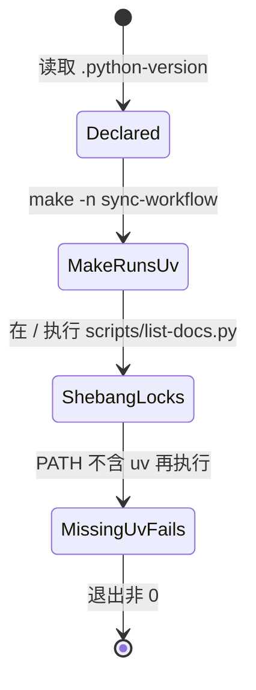

# Tasks: pin-script-python-with-uv

## Verification Strategy

| 问题 | 回答 |
|------|------|
| **验证类型** | `e2e-script` |
| **选择理由** | 要证明的是真实进程的解释器版本和失败路径，不是单元测试里的字符串。 |
| **验证入口** | 在仓库根运行下面的脚本。它检查 `.python-version`、`make -n sync-workflow`、仓库外直接执行 shebang，以及 PATH 上没有 uv 时的退出码。 |
| **probe 证据** | `uv run --no-project --python 3.12` 在仓库外、conda 位于 PATH 前面时打印 `3.12.13`，解释器路径含 `cpython-3.12`，退出码 0。不带 `--python` 时同一条件选中 miniconda 3.14.7。`PATH=/usr/bin:/bin` 调用 uv 退出码 127。 |
| **未验证假设** | N/A |

验证入口命令：

```bash
set -eu
test "$(tr -d '[:space:]' < .python-version)" = "3.12"
make -n sync-workflow | grep -F 'uv run --no-project --python 3.12 python scripts/sync-workflow.py'
root=$PWD
tmp=$(mktemp -d)
cat > "$tmp/sitecustomize.py" <<'PY'
import sys
from pathlib import Path
Path("/tmp/kandev-uv-pin-evidence").write_text(sys.version.split()[0] + "\n" + sys.executable + "\n")
PY
rm -f /tmp/kandev-uv-pin-evidence
( cd / && PYTHONPATH="$tmp" "$root/scripts/list-docs.py" --root "$root" validate )
grep -q '^3\.12\.' /tmp/kandev-uv-pin-evidence
grep -q 'cpython-3.12' /tmp/kandev-uv-pin-evidence
if ( cd / && PATH="/usr/bin:/bin" "$root/scripts/list-docs.py" validate >/tmp/kandev-uv-pin-missing.out 2>/tmp/kandev-uv-pin-missing.err ); then
  echo "missing uv should fail" >&2
  exit 1
fi
echo "pin verification passed"
rm -rf "$tmp"
```

apply 按本文件从上到下实现。每条 task 有自己的文件边界和准出。全部完成并跑通上面的入口后，再进入 verify / archive。

## E2E 测试图



### 节点说明

| 节点 | 状态描述 | 断言 |
|------|---------|------|
| Declared | 仓库声明了次要版本 | 文件内容去掉空白后等于 `3.12` |
| MakeRunsUv | Make 展开后的命令走 uv | dry-run 含 `uv run --no-project --python 3.12 python scripts/sync-workflow.py` |
| ShebangLocks | 仓库外直接执行仍是 uv 的 3.12 | `sitecustomize` 记下的版本以 `3.12.` 开头，路径含 `cpython-3.12`，`list-docs.py validate` 退出 0 |
| MissingUvFails | 找不到 uv 时不跑脚本主体 | 退出码非 0 |

### 核心覆盖路径

1. **路径 1**：声明文件 → Make dry-run → 仓库外 shebang 执行 `list-docs.py validate` → 去掉 uv 后再执行并确认失败。

## 实现清单

### 1. 声明版本并改维护入口

- [x] 1.1 新增 `.python-version`，内容只有 `3.12` 和一个换行（`.python-version`）。准出：`tr -d '[:space:]' < .python-version` 输出 `3.12`。
- [x] 1.2 根 Makefile 增加 `REPO_PYTHON := uv run --no-project --python 3.12 python`，并把 13 处 `python3` 加仓库脚本的配方改成 `$(REPO_PYTHON)`（`Makefile`）。准出：`make -n sync-workflow` 含 `uv run --no-project --python 3.12 python scripts/sync-workflow.py`。
- [x] 1.3 `.pre-commit-config.yaml` 四个 `python3` hook 改为 `uv run --no-project --python 3.12 python` 加原脚本和原参数（`.pre-commit-config.yaml`）。准出：这四个 entry 不再以 `python3` 开头，并包含 `--python 3.12`。
- [x] 1.4 `scripts/demo-team-access.sh` 的 seed 调用，以及 `scripts/sync-workflow.test.sh` 里三次执行 `sync-workflow.py` 的命令和对 `make -n` 的断言，改为同一条 uv 命令。`python3 -c` 与 heredoc 不改（`scripts/demo-team-access.sh`、`scripts/sync-workflow.test.sh`）。准出：这两个文件里执行仓库 `.py` 的行含 `--python 3.12`；`python3 -c` 仍在。
- [x] 1.5 把 `scripts/**/*.py` 与 `.github/scripts/**/*.py` 里已有的 `#!/usr/bin/env python3` 换成 `#!/usr/bin/env -S uv run --no-project --python 3.12 --script`。不新增 shebang，不改 `docs/plans/`（这两个目录下的 `.py`）。准出：这两个目录不再有 `#!/usr/bin/env python3`，且每个原 shebang 文件的第一行是新的 uv shebang。
- [x] 1.6 更新根 `AGENTS.md` 的 Tooling 说明和 Knowledge 小节里三处现行 `python3 scripts/...` 命令（`AGENTS.md`）。准出：这三处命令包含 `uv run --no-project --python 3.12 python`。

## 验证清单

- [x] 路径 1 验证：跑 Verification Strategy 里的入口脚本，声明、Make、仓库外 shebang、缺 uv 失败都符合节点断言。
- [x] 运行测试：`bash scripts/sync-workflow.test.sh`
- [x] 运行 lint / typecheck：`uv run --no-project --python 3.12 python scripts/lint-spec-files.py --all` 与 `openspec validate pin-script-python-with-uv --strict --no-interactive`
