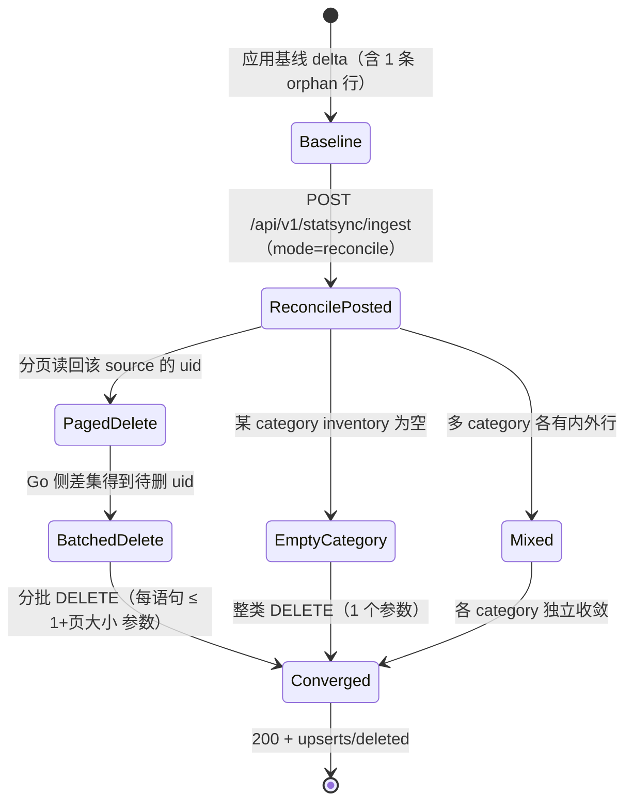

# Tasks: fix-statsync-reconcile-parameter-limit

**Goal:** 让 reconcile 删除的每一条 SQL 语句绑定参数数量与 inventory 规模无关，同时保持删除语义、事务原子性与 HTTP 契约不变。

**Architecture:** 分页读回该 source 的现有 uid → Go 侧与 inventory 求差 → 按批 `DELETE ... IN (...)`；inventory 永不进入 SQL。

**Spec:** `openspec/changes/fix-statsync-reconcile-parameter-limit/proposal.md` + `specs/stats-sync/spec.md`

## 全局约束与审查重点

- Go 代码注释用英文并陈述不变量；OpenSpec 与任务文档用中文。
- 不新增依赖、配置项或 feature flag；不改镜像表 schema/视图/索引。
- 所有语句必须经 `tx.Rebind`（sqlguard `raw-placeholder` 规则），不得直接拼接 uid 值。
- 生产函数保持 ≤80 行、圈复杂度 ≤15（`apps/backend/.golangci.yml`）。
- 审查重点（最可能被误伤、且测试必须钉住）：① 另一个 source 的镜像行不得被删除（2.4）；② inventory 内重复 uid 不得报错或误删（2.3）；③ 空 category 短路不得连带删除其它 category（2.2）；④ 分页游标在删除行后不得漏页（2.1）；⑤ `deleted` 只累加直接删除的行，级联子行不重复计入（2.3 断言精确值）。

## Verification Strategy

| 问题 | 回答 |
|------|------|
| **验证类型** | `integration-test`（包内真实 SQLite + gin 路由 HTTP 验收 + env-gated PostgreSQL） |
| **选择理由** | 故障发生在 repository 的 SQL 构造层：只有用真实数据库执行那条 DELETE 才能复现 "too many SQL variables"；HTTP 层验收保证 ingest 契约与状态码不变。纯单测无法证明任何一条语句的参数数量。 |
| **验证入口** | 聚焦：`cd apps/backend && go test ./internal/statsync/ -count=1 -run 'Reconcile|Ingest'`；全包：`cd apps/backend && go test ./internal/statsync/ -count=1`；PG：`KANDEV_TEST_POSTGRES_DSN=... go test ./internal/statsync/ -count=1 -run Postgres` |
| **probe 证据** | Explore 探针直接调用 `deleteOutsideInventory`：`inventory=32765 params=32766 err=<nil>`；`inventory=32766 params=32767 err=reconcile statsync_messages: too many SQL variables`（与生产日志逐字一致）。驱动源码 `sqlite3-binding.c:14458` 为 `# define SQLITE_MAX_VARIABLE_NUMBER 32766`（mattn/go-sqlite3 v1.14.33 / SQLite 3.51.1）。 |
| **未验证假设** | PostgreSQL 行为：本机 `KANDEV_TEST_POSTGRES_DSN` 未设置、Docker 不可用。验证入口为 task 3.2 的 `TestReconcileDeletesOutsideInventoryPostgres`，在提供 DSN 的 CI 中执行；未跑通前不得声称 PG 已验证。 |

## E2E 测试图



### 节点说明

| 节点 | 状态描述 | 断言 |
|------|---------|------|
| Baseline | 镜像表含该 source 的完整行链 + 1 条 inventory 外的 orphan | 各行数与夹具一致 |
| ReconcilePosted | 收到 `mode=reconcile` 且 inventory 达 32767 个 message uid | 请求被接受，不再返回 500 |
| PagedDelete | 按 `source_instance` + uid 游标分页读取现有 uid | 页大小受 `inventoryChunkSize` 控制，游标只前进 |
| BatchedDelete | 差集非空时按批删除 | 单条语句参数 ≤ `1 + inventoryChunkSize` |
| Converged | 删除完成并提交事务 | inventory 内行全部保留、inventory 外行全部删除、`deleted` 为直接删除行数之和 |
| EmptyCategory | 某 category inventory 为空 | 该 source 在该 category 的行全部删除，其它 category 不受影响 |
| Mixed | 多个 category 各有 inventory 内外行 | 每个 category 独立收敛，互不误删 |

### 核心覆盖路径

1. **路径 1（原故障回归）**：Baseline → ReconcilePosted（32767 uid）→ PagedDelete → BatchedDelete → Converged — 不再出现 `too many SQL variables`，orphan 被删、inventory 内行保留。
2. **路径 2（分页边界）**：Baseline（8 行）→ 页大小注入为 2 → Reconcile → Converged — 跨页保留/删除正确。
3. **路径 3（空 category）**：Baseline → Reconcile（messages inventory 为空）→ EmptyCategory → Converged — 整类删除且不误伤其它 category。
4. **路径 4（多 category 混合）**：Baseline → Reconcile（各 category 部分命中）→ Mixed → Converged — 每类各自收敛。
5. **路径 5（HTTP 契约）**：路由 POST → 200 且响应体含 `upserts`/`deleted` — 不因规模改变状态码。

## 实现清单

> 按顺序执行；每条 task 以独立测试通过为准出。apply 阶段完成全部 task 后才进入 verify / archive。

### 1. 重写对账删除策略（生产代码 + 原故障回归）

**Files:**
- Modify: `apps/backend/internal/statsync/repository.go:326-375`
- Create: `apps/backend/internal/statsync/repository_reconcile_test.go`

**Interfaces:**
- Consumes: `applyEnvelope` 在 `repository.go:313-319` 调用 `deleteOutsideInventory(tx *sqlx.Tx, source string, inv *Inventory) (int64, error)`；`countRows(t, db, table)` 与 `newTestRepository`、`testDB`、`validEnvelope` 来自同包既有测试文件。
- Produces（同包内使用）：
  - `var inventoryChunkSize = 500`（原 const 改为 var）
  - `func deleteOutsideInventory(tx *sqlx.Tx, source string, inv *Inventory) (int64, error)`（签名不变）
  - `func deleteCategoryOutsideInventory(tx *sqlx.Tx, table, source string, keep map[string]struct{}) (int64, error)`
  - `func deleteUIDBatches(tx *sqlx.Tx, table, source string, uids []string) (int64, error)`
  - `func uidSet(uids []string) map[string]struct{}`
  - 测试侧：`func withInventoryChunkSize(t *testing.T, size int)`、`func inventoryFromEnvelope(env *Envelope) *Inventory`

- [x] **1.1 新建测试文件，写入夹具助手与失败测试**

在 `apps/backend/internal/statsync/repository_reconcile_test.go` 写入包声明 `package statsync`、`withInventoryChunkSize`、`inventoryFromEnvelope`，以及：

```go
func TestApplyReconcileLargeInventoryExceedsStatementBudget(t *testing.T) {
	db := testDB(t)
	repo := newTestRepository(t, db)
	ctx := context.Background()

	env := validEnvelope()
	for i := range env.Tasks {
		env.Tasks[i].ResolvedWorkspaceID = "ws-local"
	}
	if _, err := repo.ApplyDelta(ctx, env); err != nil {
		t.Fatalf("apply base payload: %v", err)
	}
	// One row the inventory will omit, modelling a remote deletion.
	orphan := &Envelope{SchemaVersion: SchemaVersion, SourceInstance: "remote-1", Mode: ModeDelta}
	orphan.Messages = []MessageRow{{
		UID: "remote-1:msg-orphan", SessionUID: "remote-1:sess-1",
		AuthorType: "user", Type: "text", CreatedAt: "2026-10-11T09:05:02Z",
	}}
	if _, err := repo.ApplyDelta(ctx, orphan); err != nil {
		t.Fatalf("apply orphan payload: %v", err)
	}

	inv := inventoryFromEnvelope(env)
	for i := 0; i < 32766; i++ {
		inv.Messages = append(inv.Messages, fmt.Sprintf("remote-1:bulk-%d", i))
	}
	reconcile := &Envelope{SchemaVersion: SchemaVersion, SourceInstance: "remote-1",
		Mode: ModeReconcile, Inventory: inv}
	result, err := repo.ApplyReconcile(ctx, reconcile)
	if err != nil {
		t.Fatalf("ApplyReconcile with %d message uids: %v", len(inv.Messages), err)
	}
	if got := countRows(t, db, "statsync_messages"); got != 1 {
		t.Fatalf("messages after reconcile = %d, want 1 (inventory row kept, orphan deleted)", got)
	}
	if result.Deleted != 1 {
		t.Fatalf("Deleted = %d, want 1 (only the orphan)", result.Deleted)
	}
}
```

准出：文件可编译（`go vet ./internal/statsync/` 通过），测试名存在。

- [x] **1.2 运行该测试，确认以生产同款错误失败**

Run: `cd apps/backend && go test ./internal/statsync/ -count=1 -run TestApplyReconcileLargeInventoryExceedsStatementBudget -v`
Expected: FAIL，输出含 `reconcile statsync_messages: too many SQL variables`。

- [x] **1.3 重写 `deleteOutsideInventory` 及其助手**

在 `apps/backend/internal/statsync/repository.go`：

把 326-329 行的 const 与注释替换为：

```go
// inventoryChunkSize bounds one uid page and one delete batch, so every
// statement the reconcile executes binds a fixed number of parameters
// (at most 1+inventoryChunkSize) regardless of how large the inventory is.
// The limit is per statement, not per clause: chaining clauses inside one
// statement would still exceed a driver's bound-parameter ceiling.
var inventoryChunkSize = 500
```

把 331-375 行的函数体替换为（函数签名与错误文本前缀 `reconcile %s` 保持不变）：

```go
func deleteOutsideInventory(tx *sqlx.Tx, source string, inv *Inventory) (int64, error) {
	categories := []struct {
		table string
		uids  []string
	}{
		{"statsync_tasks", inv.Tasks},
		{"statsync_task_repositories", inv.TaskRepositories},
		{"statsync_sessions", inv.Sessions},
		{"statsync_turns", inv.Turns},
		{"statsync_messages", inv.Messages},
		{"statsync_commits", inv.Commits},
		{"statsync_git_snapshots", inv.GitSnapshots},
		{"statsync_repositories", inv.Repositories},
	}
	var deleted int64
	for _, category := range categories {
		count, err := deleteCategoryOutsideInventory(tx, category.table, source, uidSet(category.uids))
		if err != nil {
			return 0, err
		}
		deleted += count
	}
	return deleted, nil
}
```

新增助手（同一文件、紧随其后）：

- `uidSet(uids []string) map[string]struct{}`：把 inventory 变成集合；重复 uid 天然去重。
- `deleteCategoryOutsideInventory(tx *sqlx.Tx, table, source string, keep map[string]struct{}) (int64, error)`：
  - `len(keep) == 0` 时执行 `DELETE FROM <table> WHERE source_instance = ?`（经 `tx.Rebind`），返回 `RowsAffected`。
  - 否则循环：`tx.Select(&page, tx.Rebind("SELECT uid FROM "+table+" WHERE source_instance = ? AND uid > ? ORDER BY uid LIMIT ?"), source, after, inventoryChunkSize)`；空页即结束；`after = page[len(page)-1]`；收集 `keep` 之外的 uid，交给 `deleteUIDBatches` 累加。
  - 错误文本：读页 `fmt.Errorf("list %s uids: %w", table, err)`；删除沿用 `fmt.Errorf("reconcile %s: %w", table, err)` 与 `fmt.Errorf("reconcile %s rows affected: %w", table, err)`。
- `deleteUIDBatches(tx *sqlx.Tx, table, source string, uids []string) (int64, error)`：按 `inventoryChunkSize` 切片，每片用 `sqlx.In("DELETE FROM "+table+" WHERE source_instance = ? AND uid IN (?)", source, batch)` 构造后 `tx.Rebind` 执行，累加 `RowsAffected`；空切片不得发出任何语句。

同时把 331-335 行函数文档注释改为陈述不变量：inventory 不出现在 SQL 中；按 uid 游标分页读回、Go 侧求差、按批删除；空 inventory 删除整个 category；所有语句在同一事务内。

准出：`deleteOutsideInventory` 不再拼接 `NOT IN` 子句，单条语句参数上限为 `1 + inventoryChunkSize`。

- [x] **1.4 运行聚焦测试与全包测试**

Run: `cd apps/backend && go test ./internal/statsync/ -count=1 -run TestApplyReconcileLargeInventoryExceedsStatementBudget -v`
Expected: PASS。
Run: `cd apps/backend && go test ./internal/statsync/ -count=1`
Expected: PASS（既有 reconcile 用例全部保持通过）。

- [x] **1.5 提交**

```bash
git add apps/backend/internal/statsync/repository.go apps/backend/internal/statsync/repository_reconcile_test.go
git commit -m "fix(statsync): delete reconcile rows with bounded statements"
```

### 2. 分页与分类正确性覆盖（测试）

**Files:**
- Modify: `apps/backend/internal/statsync/repository_reconcile_test.go`

**Interfaces:**
- Consumes: task 1 的 `withInventoryChunkSize`、`inventoryFromEnvelope`、`deleteCategoryOutsideInventory` 行为。
- Produces: 无生产接口。

- [x] **2.1 跨页保留/删除用例**

`TestApplyReconcileKeepsInventoryAcrossPages`：`withInventoryChunkSize(t, 2)`；构造 8 条 message（`remote-1:msg-1`…`msg-8`）与完整父链；inventory 列 `msg-1`…`msg-7`；reconcile 后断言 `statsync_messages` 为 7 行且剩余集合恰为 `msg-1`…`msg-7`。

- [x] **2.2 空 category 整类删除用例**

`TestApplyReconcileEmptyCategoryDeletesWholeCategory`：先应用 `validEnvelope()`，再以"除 `Messages` 外全部列出"的 inventory reconcile；断言 `statsync_messages` 为 0，`statsync_tasks`/`statsync_sessions`/`statsync_turns`/`statsync_commits` 各为 1。

- [x] **2.3 多 category 混合与重复 uid 用例**

`TestApplyReconcileDeletesOutsideInventoryPerCategory`：在存活 session 下分别造一条 inventory 外的 message、commit、turn；inventory 列父链但省略这三条；断言三张子表各删 1 行、父表行数不变，且 `result.Deleted == 3`（只累加直接删除行）。另在 inventory 中对同一条 message uid 重复列两次，断言删除结果与去重前一致（不报错、不误删）。

- [x] **2.4 其它 source 不受影响用例**

`TestApplyReconcileLeavesOtherSourcesIntact`：应用 `remote-1` 的完整行链，再以 `SourceInstance: "remote-2"` 应用一条独立行链（`remote-2:task-1` / `remote-2:sess-1` / `remote-2:msg-1`，父链齐全）；随后用"省略 `remote-1:msg-1`"的 inventory reconcile `remote-1`。断言 `remote-1:msg-1` 被删除，`remote-2` 的 task/session/message 全部保留（分页与删除都按 `source_instance` 过滤）。

- [x] **2.5 运行并提交**

Run: `cd apps/backend && go test ./internal/statsync/ -count=1 -run 'ApplyReconcile' -v`
Expected: 全部 PASS，含既有的 `TestApplyReconcileDeletesOutsideInventoryWithCascade` 与 `TestApplyReconcileEmptyInventoryClearsSource`。

```bash
git add apps/backend/internal/statsync/repository_reconcile_test.go
git commit -m "test(statsync): cover reconcile paging and category scoping"
```

### 3. HTTP 验收与 PostgreSQL 门禁

**Files:**
- Modify: `apps/backend/internal/statsync/repository_reconcile_test.go`

**Interfaces:**
- Consumes: `newHandlerTestRouter(t)`、`ingestBody(t, mutate)`、`postIngest(router, body, secret)`（`handlers_test.go`，同包）；`testutil.PostgresDSNFromEnv(t)`、`testutil.OpenIsolatedPostgres(t, dsn)`、`seedCoreAnalyticsFixture(t, db)`。
- Produces: 无生产接口。

- [x] **3.1 HTTP 层规模验收**

`TestIngestHandlerAcceptsReconcileAtProductionInventoryScale`：用 `newHandlerTestRouter(t)`；第一次 POST 的基线 delta 在 `validEnvelope()` 上追加一条 `remote-1:msg-orphan`（不属于 inventory，用于产生非零 `deleted`）；第二次 POST 的 reconcile 体由 `inventoryFromEnvelope(validEnvelope())` 再追加 32766 个 `remote-1:bulk-N` 的 message uid 组成；断言 `rec.Code == http.StatusOK`，响应 JSON 的 `deleted` 为 1。

- [x] **3.2 PostgreSQL 行为测试（env-gated）**

`TestReconcileDeletesOutsideInventoryPostgres`：`dsn := testutil.PostgresDSNFromEnv(t)`；`db := testutil.OpenIsolatedPostgres(t, dsn)`；`seedCoreAnalyticsFixture(t, db)`；`repo := newTestRepository(t, db)`；`withInventoryChunkSize(t, 2)`；应用 `validEnvelope()`（`ResolvedWorkspaceID = "ws-local"`）与一条 orphan message，用包含 `msg-1` 的 inventory reconcile；断言 `statsync_messages` 为 1（orphan 删除、`msg-1` 保留）、`result.Deleted == 1`，且 `statsync_tasks`/`statsync_sessions`/`statsync_turns`/`statsync_commits` 各为 1。

准出：本机因无 DSN 而 SKIP，不得记为通过；测试在设置 `KANDEV_TEST_POSTGRES_DSN` 时必须通过。

- [x] **3.3 运行聚焦验证、lint 与 sqlguard**

Run: `cd apps/backend && go test ./internal/statsync/ -count=1`
Expected: PASS（PG 用例显示 SKIP）。
Run（仓库根）: `bash scripts/lint-go-changed apps/backend/internal/statsync/repository.go apps/backend/internal/statsync/repository_reconcile_test.go`
Expected: 无新增告警。
Run（仓库根）: `go -C apps/backend run ./cmd/sqlguard ./internal`
Expected: `sqlguard` 报告 0 违规。

- [x] **3.4 提交**

```bash
git add apps/backend/internal/statsync/repository_reconcile_test.go
git commit -m "test(statsync): verify reconcile contract at HTTP scale and on postgres"
```

## 验证清单

- [x] 路径 1：`TestApplyReconcileLargeInventoryExceedsStatementBudget` 通过——32767 个 message uid 不再触发 `too many SQL variables`，orphan 删除、inventory 内行保留。
- [x] 路径 2：`TestApplyReconcileKeepsInventoryAcrossPages` 通过——页大小 2 时跨页保留/删除正确。
- [x] 路径 3：`TestApplyReconcileEmptyCategoryDeletesWholeCategory` 通过——空 category 整类删除且不误伤其它表。
- [x] 路径 4：`TestApplyReconcileDeletesOutsideInventoryPerCategory` 通过——多 category 各自收敛，重复 uid 不报错。
- [x] 路径 5：`TestIngestHandlerAcceptsReconcileAtProductionInventoryScale` 通过——HTTP 200 且响应含 `deleted`。
- [x] 边界：`TestApplyReconcileLeavesOtherSourcesIntact` 通过——`remote-1` 的 reconcile 不触碰 `remote-2` 的任何行。
- [ ] PG：`TestReconcileDeletesOutsideInventoryPostgres` 在提供 `KANDEV_TEST_POSTGRES_DSN` 的环境通过；本机 SKIP 需在 verify 中如实记录为未验证。
- [x] 运行测试：`cd apps/backend && go test ./internal/statsync/ -count=1`（本机 shell 的 `cd` 受 gvm 干扰时改用 `go -C apps/backend test ./internal/statsync/ -count=1`）。
- [x] 运行 lint：`bash scripts/lint-go-changed <changed-go-files>`。
- [x] 运行 sqlguard：`go -C apps/backend run ./cmd/sqlguard ./internal`。
- [x] 全量后端：`make -C apps/backend test` 仅在与改动前基线的逐名 diff 中判"零新增失败"（本机存在既有失败）。结果：基线 `9c81855338` 与改动后各 21 个失败包，包名集合完全一致（仅耗时不同），零新增；`internal/statsync` 两处均为 `ok`。
- [x] 确认 `repository.go` 中不再出现 `AND uid NOT IN` 拼接，且注释不再声称"chaining clauses 可压低参数上限"。
