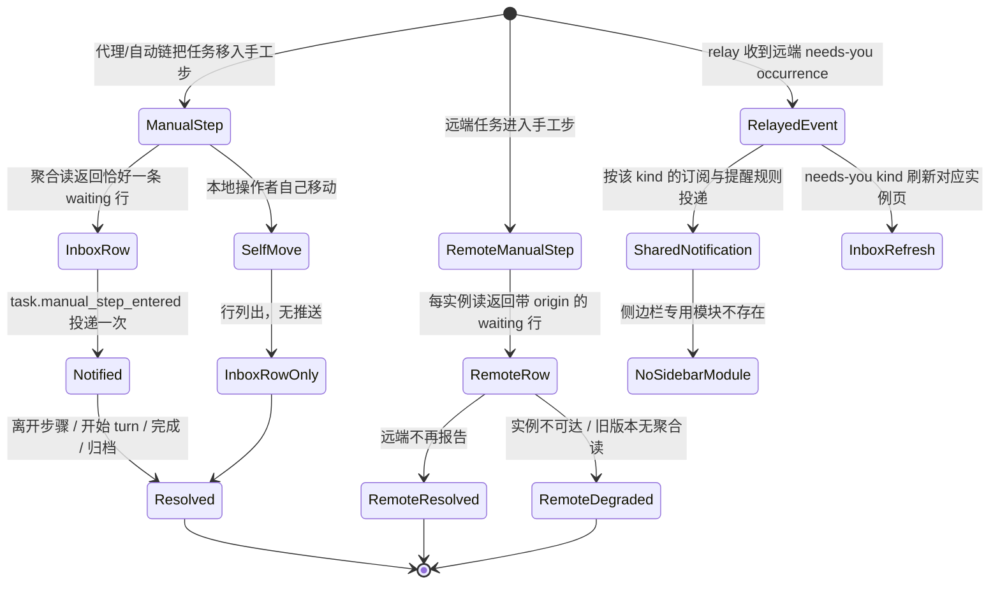

# Tasks: needs-you-inbox-waiting-rows

## Verification Strategy

| 问题 | 回答 |
|------|------|
| **验证类型** | `integration-test` + `e2e-script`（后端跨层集成测试 + Playwright E2E）。`unit-test` 只作为实现过程手段，不作为唯一验收依据。 |
| **选择理由** | 行为跨越 orchestrator 事件、notification service、relay、Inbox 聚合读、前端 store/WS、远端 per-instance 组合，单层单测无法证明 count/list 同源、relay 去重与降级隔离。 |
| **验证入口** | 后端：`go test ./internal/orchestrator/... ./internal/notifications/... ./internal/clarification/... ./internal/task/repository/sqlite/... ./internal/instances/... ./internal/backendapp/...`。前端：`pnpm vitest run ...`、`pnpm run typecheck`、`pnpm run i18n:check`、`pnpm run i18n:ratchet`。E2E：`pnpm e2e:run --grep "waiting rows"`、`pnpm e2e:run --grep "multi-instance"`。OpenSpec/docs：`openspec validate --all --strict`、`uv run --no-project --python 3.12 python scripts/list-docs.py validate`、`scripts/lint-spec-files.py --all`。 |
| **probe 证据** | Explore 已只读验证：手工步等待收敛点 11 处；`task_step_transitions` 含 actor 列但读取模型未 select；`recipients` 对远端 task_id 解析失败；Local provider payload 无 origin；远端组合为 SPA 侧；`tauri-plugin-notification` 2.3.3 无桌面点击回调、2.6.0 才提供 `on_action`。证据见 `design.md` Research Log 与 `proposal.md` Research Log。 |
| **未验证假设** | 无。桌面通知打开动作已作为「拒绝理由 + 用户决策」关闭（D8）；不依赖插件升级。 |

## Review Focus

以下输入/失败模式最容易在实现后仍出问题，每一条都在对应 task 的测试里有断言：

1. **手工步带非启动 on_enter（如 `reset_agent_context`）**：走 `launchAfterOnEnterDispatch` 而不是 `:4580` 分支，必须仍发一次通知。测试在 1.2。
2. **无 session 任务 / 有排队 prompt 的任务**：前者必须列出，后者不得列出。测试在 2.1。
3. **relayed occurrence 的远端 task_id**：不得被本地 owner 解析丢弃，也不得写入本地 occurrence 历史。测试在 3.1、3.2。
4. **既有安装的默认 provider**：升级后必须收到新事件，用户之后取消订阅不得被回填。测试在 1.5。
5. **旧版本/不可达远端**：必须只降级该实例，不得拖垮本地读或其他实例。测试在 4.1、4.3、4.5。
6. **question 行行为回归**：`bundles` 改为 `rows` 后，展开回答、hidden、late-answer 路径必须不变。测试在 2.5、2.7。
7. **flag-off 面板**：侧边栏模块删除后，multiInstance 或 needsYouInbox 关闭时行为必须与今天一致。测试在 3.5。

## E2E 测试图

### 节点说明

| 节点 | 状态描述 | 断言 |
|------|---------|------|
| ManualStep | 任务处于手工步，无执行中/排队 turn | 聚合读只列一条 waiting 行，命名任务与步骤 |
| InboxRow | waiting 行已渲染 | `kind=waiting`，无 inline answer，菜单含打开/忽略/稍后 |
| Notified | episode 开始通知已投递 | 与 clarification 同 provider/声音/原生通知；同 episode 只一次 |
| SelfMove | 本人移动进入手工步 | 行仍列出；无声音/原生通知 |
| Resolved | episode 结束 | 下一次 re-read 移除行；新 episode 产生新行且不继承隐藏 |
| RemoteRow | 远端 waiting 行 | 带实例与 origin workspace 标签；打开走标准 instance-switch |
| RemoteDegraded | 远端不可达/旧版本 | 该实例 section 降级并可重试；本地与其他实例照常列出 |
| RelayedEvent | relay 收到 occurrence | store 去重后只投一次；不写本地 occurrence 历史 |
| SharedNotification | 统一通知投递 | 订阅了才提醒；默认安静 kind 保持安静；origin 标签可见 |
| NoSidebarModule | 侧边栏模块已移除 | 桌面与手机导航均无该模块；flag-off 行为与今天一致 |

### 核心覆盖路径

1. **本地等待 episode**：移入手工步 → waiting 行出现 → 通知一次 → 移出/开始 turn → 行消失。
2. **本人移动**：本地操作者移动 → 行出现、无推送 → 移出 → 行消失。
3. **远端等待**：远端任务进入手工步 → 本地 Inbox 远端 section 出现带 origin 的行 → 远端移出/旧版本 → 行消失或降级，本地读不受影响。
4. **统一通知**：relayed clarification 与 manual-step 按订阅提醒并刷新对应实例页；`session.turn_finished` 不改 Inbox；侧边栏模块不存在。

## 实现清单

> 顺序执行：1 → 2 → 3 → 4 → 5。每完成一组再进入下一组；不要提前删除侧边栏模块（组 3），它依赖组 2 的新 refresh 触发已落地。

### 1. Manual-step episode notification（Task 01）

**Files:** `apps/backend/internal/orchestrator/manual_step_wait.go`（新建）、`event_handlers_workflow.go`、`apps/backend/internal/task/models/step_transitions.go`、`apps/backend/internal/task/repository/sqlite/step_transitions.go`、`apps/backend/internal/notifications/service/service.go`、`apps/backend/internal/notifications/store/sqlite.go`、`apps/backend/internal/backendapp/gateway.go`、`apps/web/lib/notifications/events.ts`、`apps/web/lib/ws/handlers/notifications.ts`、`apps/web/components/settings/notification-events-table.tsx`、7 个 `settings.json`。

**Interfaces:**
- `taskmodels.StepTransition` 增加 `ActorKind string`、`ActorID string`；`Repository.GetLatestStepTransitionForStep(ctx, taskID, toStepID string) (*taskmodels.StepTransition, error)`。
- `events.TaskManualStepEntered = "task.manual_step_entered"`；bus payload 含 `task_id`、`session_id`、`workflow_step_id`、`occurrence_id`、`actor_kind`、`actor_id`、`occurred_at`。
- `notifications.Service.HandleManualStepWait(ctx, taskID, sessionID, occurrenceID, actorKind, actorID string)`。
- `notificationPayload` / `providers.Message` 增加 `OriginInstanceID`、`OriginInstanceName`（组 3 使用，组 1 先落字段）。
- 前端事件常量 `NOTIFICATION_EVENT_TASK_MANUAL_STEP_ENTERED`。

- [x] 1.1 为 `task_step_transitions` 读取模型补 `actor_kind`/`actor_id`，新增按 `(task_id, to_workflow_step_id)` 取最新行的 repository 方法；测试覆盖 actor 透传与无行回退（`apps/backend/internal/task/repository/sqlite/step_transitions_test.go`）。
- [x] 1.2 写失败测试：手工步（无 on_enter 与仅 `reset_agent_context` 两种）各发一次 `task.manual_step_entered`；自动启动步、complete-on-enter 步不发；同一 episode 的多次 waiting 收敛不重复（`apps/backend/internal/orchestrator/manual_step_wait_test.go`）。
- [x] 1.3 实现 `manualStepWaitNotifier`：读最新 transition、判定 `!StepRunsOnEntry && !CompleteTaskOnEnter`、生成 `mw:<task>:<step>:<transitionID>`、publish bus；在 `publishSessionWaitingEvent` 内调用一次，并给无 session 的手工步入口补一次调用（`manual_step_wait.go`、`event_handlers_workflow.go`）。
- [x] 1.4 通知服务新增事件常量、`AvailableEvents` 条目、`HandleManualStepWait`；`handleSemanticOccurrence` 增加可排除的 actor user（human 且 actor 为空时映射 `userstore.DefaultUserID`）；测试覆盖本人移动不投递、他人/agent 移动投递（`notifications/service/service_test.go`）。
- [x] 1.5 新增一次性迁移 `manualStepWaitSubscriptionMigration`，给 type 为 local/system 且缺少该订阅的 provider 补订阅；测试覆盖只补一次、用户后续取消不回填（`notifications/store/sqlite_test.go` 或新文件）。
- [x] 1.6 gateway 订阅 `task.manual_step_entered` 并调用 `HandleManualStepWait`；测试断言 bus payload 到 service 的接线（`backendapp/gateway_test.go`）。
- [x] 1.7 前端新增事件常量、handler 条目（播放等待音、无打开动作）、设置页事件标签文案；补 7 locale，zh-tw/zh-hk 用 `pnpm run i18n:zh-hant`（`lib/notifications/events.ts`、`lib/ws/handlers/notifications.ts`、`notification-events-table.tsx`、`src/locales/*/settings.json`）。
- [x] 1.8 跑组 1 验证：`go test ./internal/orchestrator/... ./internal/notifications/... ./internal/task/repository/sqlite/...`、`pnpm vitest run lib/ws/handlers/notifications.test.ts components/settings/notification-events-table.test.tsx`、`pnpm run i18n:check`。

### 2. Local waiting rows and the merged Inbox read（Task 02）

**Files:** `apps/backend/internal/task/models/needs_you_waiting.go`（新建）、`apps/backend/internal/task/repository/sqlite/needs_you_waiting_query.go`（新建）、`apps/backend/internal/clarification/needs_you_inbox_handlers.go`（新建）、`clarification/handlers.go`、`clarification/inbox_handlers.go`、`backendapp/helpers.go`、`backendapp/boot_state_routes.go`、`apps/web/lib/types/needs-you-inbox.ts`（新建）、`apps/web/lib/api/domains/needs-you-inbox-api.ts`（新建）、`apps/web/lib/state/slices/needs-you-inbox/*`、`apps/web/hooks/domains/needs-you-inbox/use-needs-you-inbox-controller.ts`、`apps/web/app/needs-you-inbox/needs-you-inbox-page-client.tsx`、`apps/web/components/needs-you-inbox/*`、`src/locales/*/needsYouInbox.json`。

**Interfaces:**
- `taskmodels.ManualStepWaitRow{ID, TaskID, TaskTitle, WorkspaceID, StepID, StepName, ReferenceTime, SidecarState, SnoozeUntil}`；`ManualStepWaitOptions{WorkspaceID, Limit, Sidecar, OnlyHidden}`；`ManualStepWaitPage{Rows, HiddenCount, HasMore, NextSnoozeExpiry}`。
- `GET /api/v1/needs-you-inbox`、`GET /api/v1/needs-you-inbox/hidden`；响应 `{rows, count, hidden_count, has_more, next_snooze_expiry}`，row 含 `kind`。
- `NeedsYouInboxRow = QuestionRow | WaitingRow`；前端 `listNeedsYouInbox`、`listHiddenNeedsYouInbox`。
- `NeedsYouInboxBootSummary` 与列表复用同一个 merge helper。

- [x] 2.1 写失败测试：SQL 候选按 workspace、非终态、`complete_task_on_enter=0`、无 STARTING/RUNNING session、无 queued_messages 收窄；Go 内 `StepRunsOnEntry` 过滤；无 session 任务可列出；同一任务只一行；新 episode 身份不同（`needs_you_waiting_query_test.go`）。
- [x] 2.2 实现 `ListManualStepWaits`（含 overscan、sidecar join、hidden 枚举、`reference_time` 排序）与模型类型（`needs_you_waiting_query.go`、`needs_you_waiting.go`）。
- [x] 2.3 写失败测试：bundle 与 waiting 合并后 count/list/hidden_count/has_more 同源；排序稳定；隐藏行不占页位；本地读失败不返回部分列表（`needs_you_inbox_handlers_test.go`）。
- [x] 2.4 实现聚合 handler 与路由注册（保留 `/api/v1/clarification-inbox`）；扩展 `InboxBootSummary` 为合并 summary 并接 `boot_state_routes.go`。
- [x] 2.5 写失败测试并实现前端 API 客户端与 slice：`rows` union、`kind` 判别、waiting 行的 dismiss/snooze/restore、boot seed（`needs-you-inbox-api.test.ts`、slice/selector 测试）。
- [x] 2.6 改 controller 读新端点；新增 `task.manual_step_entered` 本地 refresh 触发；workspace 切换替换本地行、保留远端行（`use-needs-you-inbox-controller` 测试）。
- [x] 2.7 页面渲染：waiting 行（任务+步骤+菜单，无 inline answer）、混合 hidden 面板、空态/错误态文案；question 行行为不变（`needs-you-inbox-page-client.test.tsx`、row/hidden/empty 组件测试）。
- [x] 2.8 补 `needsYouInbox.json` 7 locale 文案（zh-hant 用脚本）；Threads 分类器差异测试（`lib/coordinator/attention.test.ts`）；E2E `apps/web/e2e/tests/chat/needs-you-inbox-waiting-rows.spec.ts`。
- [x] 2.9 跑组 2 验证：`go test ./internal/task/... ./internal/clarification/... ./internal/backendapp/...`、`pnpm vitest run lib/state/slices/needs-you-inbox lib/api/domains app/needs-you-inbox lib/coordinator`、`pnpm run typecheck`、`pnpm run i18n:check`、`pnpm e2e:run --grep "waiting rows"`。

### 3. Unified notification bridge and module removal（Task 03）

**Files:** `apps/backend/internal/instances/relay/relay.go`、`apps/backend/internal/backendapp/instance_relays.go`、`apps/backend/internal/notifications/service/service.go`、`providers/local.go`、`providers/system.go`、`apps/backend/internal/backendapp/helpers.go`、删除 `backendapp/remote_notification_routes.go`、`apps/backend/internal/instances/store/sqlite/store.go`（移除不再使用的展示读写方法）、`apps/web/lib/ws/handlers/notifications.ts`、删除 `lib/ws/handlers/remote-notification.ts`、删除 `components/app-sidebar/sections/notifications-section.tsx`、`components/app-sidebar/app-sidebar.tsx`、`components/navigation/app-nav-sheet.tsx`、删除 `lib/state/slices/remote-notifications/`、`hooks/domains/remote-notifications/`、`lib/api/domains/remote-notifications-api.ts`、`lib/state/default-state.ts`、`lib/ws/handlers/index.ts`、`hooks/domains/needs-you-inbox/use-remote-inbox-controller.ts`、`lib/types/backend.ts`。

**Interfaces:**
- relay `Notifier` 接口：`HandleRelayedOccurrence(ctx, userID, originInstanceID, originInstanceName, eventType, taskID, sessionID, occurrenceID, title, body string)`。
- `allowed` v2：`session.turn_finished`、`session.clarification_requested`、`office.inbox_item`、`task.manual_step_entered`。
- `notificationPayload` / `providers.Message` / Local provider payload：`origin_instance_id`、`origin_instance_name`。
- 前端 `NotificationPayload` 增加 origin 字段；`shouldSuppressNotification` 比较 active instance + task。

- [x] 3.1 写失败测试：relay v2 四种事件都进入 notifier；非 allowed 忽略；dedup 后只投一次；不广播 `ws.ActionRemoteNotification`；本地 occurrence 表无新行（`relay_test.go`）。
- [x] 3.2 实现 relay notifier 接线与 `HandleRelayedOccurrence`（显式收件人、不 `recordOccurrence`、origin 字段、remote title/body 回退本地文案）；System provider 在有 origin 时把实例名并入标题/正文（service/providers 测试）。
- [x] 3.3 写失败测试并实现前端 origin 处理：origin 标签、查看抑制按 active instance + task、needs-you relayed kind 刷新对应实例 tick、无通知打开动作（`notifications.test.ts`）。
- [x] 3.4 删除侧边栏模块、remote-notifications slice/hook/API、`remote_notification_routes.go` 与注册；移除 `REMOTE_NOTIFICATION_ACTION` listener；更新 store composition 与 handler 注册；测试断言模块/端点不存在。
- [x] 3.5 flag-off 回归：multiInstance 或 needsYouInbox 关闭时，通知与 Inbox 行为与今天一致；e2e 断言侧边栏模块缺失且无远端专用入口（`multi-instance.spec.ts`）。
- [x] 3.6 跑组 3 验证：`go test ./internal/instances/... ./internal/notifications/... ./internal/backendapp/...`、`pnpm vitest run lib/ws/handlers/notifications.test.ts components/app-sidebar lib/state/slices`、`pnpm run typecheck`、`pnpm run i18n:check`、`pnpm e2e:run --grep "multi-instance"`。

### 4. Remote waiting rows（Task 04）

**Files:** `apps/backend/internal/instances/remoteinbox/types.go`、`client.go`、`aggregate.go`、`apps/backend/internal/backendapp/instance_inbox_routes.go`、`apps/web/lib/types/remote-inbox.ts`、`apps/web/lib/api/domains/remote-inbox-api.ts`、`apps/web/hooks/domains/needs-you-inbox/use-remote-inbox-controller.ts`、`apps/web/components/needs-you-inbox/remote-inbox-section.tsx`、`apps/web/app/needs-you-inbox/needs-you-inbox-page-client.tsx`、`apps/web/e2e/tests/multi-instance/multi-instance.spec.ts`。

**Interfaces:**
- `remoteinbox.NeedsYouRow`（kind + 公共字段 + waiting 字段）、`NeedsYouPage{Rows, Count, HiddenCount, HasMore, NextSnoozeExpiry}`、`NeedsYouReadResult{Page *NeedsYouPage, Degraded Reason}`。
- `remoteinbox.Client.ReadNeedsYou(ctx, workspaceID string, limit int) NeedsYouReadResult`、`ReadNeedsYouHidden`；远端路径 `/api/v1/needs-you-inbox`、`/hidden`。
- 本地转发 `GET /api/v1/instances/:id/needs-you-inbox`（+hidden），响应复用 `instanceNeedsYouPageEnvelope`；404 → `ReasonInboxDisabled`。
- relay 在 `apps/backend/internal/backendapp/instance_relays.go:111` 构造，`initInstanceRelays` 需要接收 notification service 作为 notifier（与现有 `hub` 同层注入）。

- [x] 4.1 写失败测试：remoteinbox 按远端 workspace fan-out 读聚合端点、合并排序/截断、404→inbox_disabled、401/403→unauthorized、transport→unreachable（`client_test.go`、`aggregate_test.go`）。
- [x] 4.2 实现 remoteinbox 新类型与读方法；保持现有 clarification 读/答/sidecar 方法不变。
- [x] 4.3 写失败测试并实现本地转发路由与新 envelope；单次 fan-out、limit 校验、降级 200（`instance_inbox_routes_test.go`）。
- [x] 4.4 前端 remote controller 改读新端点；remote section 渲染 waiting 行（origin 标签、打开任务、dismiss/snooze 经现有 sidecar 转发）；旧版本/不可达降级（`use-remote-inbox-controller`、`remote-inbox-section` 测试）。
- [x] 4.5 E2E：远端 waiting 行出现/解析/降级、本地与其他实例不受影响、relayed manual-step 通知（`multi-instance.spec.ts`）。
- [x] 4.6 跑组 4 验证：`go test ./internal/instances/... ./internal/backendapp/...`、`pnpm vitest run lib/state/slices/needs-you-inbox app/needs-you-inbox`、`pnpm run typecheck`、`pnpm run i18n:check`、`pnpm e2e:run --grep "multi-instance"`。

### 5. Specification and user-doc alignment（Task 05）

**Files:** `docs/specs/ui/requirements/needs-you-inbox-waiting-rows.md`、`docs/specs/ui/system-design/needs-you-inbox-waiting-rows.md`、`docs/specs/ui/requirements/needs-you-inbox.md`、`docs/plans/needs-you-inbox-waiting-rows/plan.md` 与 task-01..05、`apps/backend/internal/instances/AGENTS.md`、`docs/public/multi-instance.md`、`docs/decisions/2026-10-28-multi-instance-federation.md`、`openspec/changes/needs-you-inbox-waiting-rows/specs/**`。

- [x] 5.1 把 `docs/specs/ui/requirements/needs-you-inbox-waiting-rows.md` 提升为 `status: active`，系统设计提升为 `status: current`；确认 AC-004.1/.3 的修订与 D8 一致。
- [x] 5.2 对 REQ-UI-NEEDS-YOU-INBOX-001 应用 supersession（AC-001.5/.6/.20/.27 的措辞），并更新 `docs/specs/ui/README.md` 的边界链接（仅在需要时）。
- [x] 5.3 更新 `docs/plans/needs-you-inbox-waiting-rows/` 的 plan 与 task-01..05：测试表编号改为 003/004/005，Results 与状态反映实际实现；不重写设计内容。
- [x] 5.4 更新 `apps/backend/internal/instances/AGENTS.md`：relay 不再只投侧边栏模块；relayed set v2；relay store 只做去重/恢复。
- [x] 5.5 更新 `docs/public/multi-instance.md` 第 3 节：远端事件按通知设置提醒、无专用侧边栏模块、远端 waiting 行与降级；移除「远端事件不弹通知」的旧表述。
- [x] 5.6 更新 ADR `2026-10-28-multi-instance-federation.md` 的 2026-10-28 revision 段：编号 003-005、统一通知、模块移除、relay store 角色；确认与 `openspec/changes/.../specs/cross-instance-notifications/spec.md` delta 一致。
- [x] 5.7 跑文档校验：`openspec validate --all --strict --no-interactive`、`uv run --no-project --python 3.12 python scripts/list-docs.py validate`、`uv run --no-project --python 3.12 python scripts/lint-spec-files.py --all`、`git diff --check -- docs openspec`。

## 验证清单

- [x] 路径 1 验证：移入手工步 → waiting 行出现 → 通知一次 → 移出/开始 turn → 行消失。
- [x] 路径 2 验证：本人移动 → 行出现、无推送；agent/他人移动 → 行出现且有推送。
- [x] 路径 3 验证：远端等待行出现、解析、旧版本/不可达降级，本地与其他实例不受影响。
- [x] 路径 4 验证：relayed clarification/manual-step 按订阅提醒并刷新对应实例页；turn_finished 不改 Inbox；侧边栏模块不存在。
- [x] 运行后端测试：`go test ./internal/orchestrator/... ./internal/notifications/... ./internal/clarification/... ./internal/task/repository/sqlite/... ./internal/instances/... ./internal/backendapp/...`
- [x] 运行前端测试与类型检查：`pnpm vitest run lib/state/slices/needs-you-inbox lib/api/domains app/needs-you-inbox lib/ws/handlers/notifications.test.ts lib/coordinator && pnpm run typecheck`
- [x] 运行 i18n：`pnpm run i18n:check && pnpm run i18n:ratchet`（zh-hant 用 `pnpm run i18n:zh-hant`）
- [x] 运行 E2E：`pnpm e2e:run --grep "waiting rows"` 与 `pnpm e2e:run --grep "multi-instance"`
- [x] 运行 OpenSpec/docs 校验：`openspec validate --all --strict --no-interactive`、`scripts/list-docs.py validate`、`scripts/lint-spec-files.py --all`
- [x] 回归确认：`features.needsYouInbox` 或 `features.multiInstance` 关闭时，Inbox、badge、通知行为与今天一致；无通知打开动作；无远端专用侧边栏模块。
