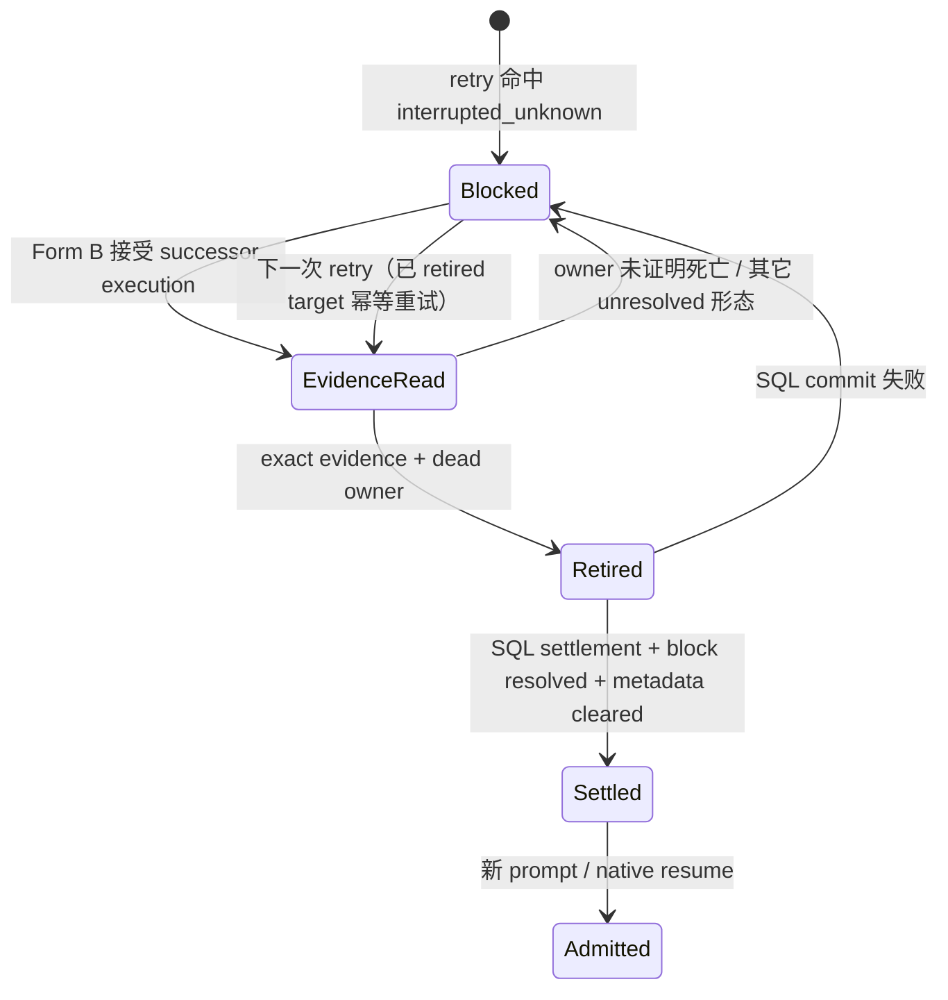
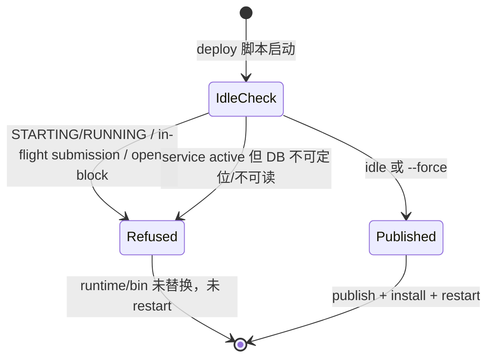
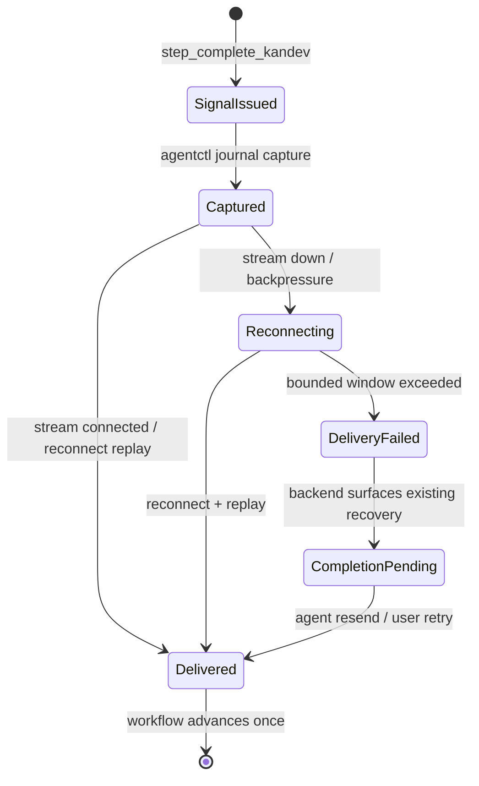

# Tasks: settle-abandoned-delivery-and-safe-deploy

**Goal:** 为 journal-present 无 terminal evidence 的 durable submission 增加保守结算与 journal retirement，让 retry 接受 recovery successor execution，让部署在重启前拒绝在途工作、给 agent drain 留足停止预算，并让 `step_complete` 信号在 agent-stream 瞬断/背压下持久捕获、重连重放且 completion-pending 可见。

**Architecture:** Form B 先解除 orchestrator 的 execution-ID guard；Form A 分为 journal retained retirement primitive → runtime retirement/death proof → SQL sibling settlement transaction → orchestrator retry 编排 → native resume retired-peer 处理。部署门禁与 systemd 预算独立交付。Form C 分为 agent-stream 健康/背压隔离 → step_complete 持久 capture/replay → completion-pending 可见性 + writer 争用观测。最后同步 docs/specs/ADR。

**Tech Stack:** Go（backend / lifecycle / agentctl journal + control HTTP + agent-stream WS）、SQLite + PostgreSQL（repository behavior tests）、bbolt（journal / pending signal store）、bash + python3（deploy gate）、systemd unit generation。

**Spec:** `openspec/changes/settle-abandoned-delivery-and-safe-deploy/design.md`、`proposal.md`、`specs/*/spec.md`。

## Global Constraints

- 所有 Go 构建/测试使用 `-trimpath`；测试与源码同包、同目录。
- 不新增表或列；新 effect type 只写入现有 `agent_delivery_effects` 文本列。
- 不删除 journal submission；只使用 `RetireSubmission` 标记 `retired` 并保留 payload/state。
- 不伪造 terminal event / sequence / turn / `fully_settled_at`；不写 `completed`/`cancelled`。
- 任何 owner 未证明死亡、descriptor 截断、存在其它 unresolved 形态或身份不匹配的场景必须 fail closed。
- 不修改前端与 i18n；retry 继续返回既有 `settled`。
- Commit 使用 Conventional Commits；commit message 末尾附 `Co-Authored-By: Claude Code <noreply@anthropic.com>`。
- 每个 task 完成后工作树必须可构建；不得留下半写入的 journal/SQL 测试状态。

## Review Focus

1. **Active SQL row 被当作 extra peer retire**：settlement 必须要求 extra peer 的 SQL 行不存在或已终态；active `prepared/accepted/dispatching/interrupted_unknown` 行一律 blocked。测试放在 Task 5。
2. **journal retire 与 SQL commit 之间崩溃**：下一次 retry 必须把已 retired target 当作可结算证据并重新提交同一 effect，不能永久 blocked。测试放在 Task 4/5。
3. **Form B 放宽后误接受 live non-successor**：移除 execution ID 等值比较后，运行时必须仍拒绝未初始化、pending prompt、incarnation/generation 不同或旧 owner 未证明死亡的 execution。测试放在 Task 1/3。
4. **部署门禁在 publish 之后才拒绝**：busy 拒绝时 `runtime/bin` 必须未被替换、`service install`/`restart` 未执行。测试放在 Task 7。
5. **自定义 DB path 导致 false idle**：服务 active 但默认路径不存在/不可读时必须拒绝，而不是当作全新安装。测试放在 Task 7。
6. **信号重放重复推进 workflow**：同一 signal 在重连、重试或 agent 重发后只能应用一次 transition；依赖 backend 既有 dedup。测试放在 Task 10。
7. **step_complete 被 event backlog 饿死**：event queue 满或 writer 慢时，step_complete 仍必须 capture/送达，其它 MCP 工具得到 typed retryable error。测试放在 Task 9/10。
8. **capture store 满/不可用**：必须返回 typed failure 并保留 agent 自救路径，不能静默丢弃。测试放在 Task 10。

## Verification Strategy

| 问题 | 回答 |
|------|------|
| **验证类型** | `integration-test`（Form A/B 主验收，使用真实 SQLite + bbolt + fake runtime HTTP）+ `e2e-script`（部署门禁） |
| **选择理由** | 结算正确性取决于跨 store 状态与事务边界，单测不足以证明；部署门禁是 shell 脚本，必须通过真实脚本 + fake HOME/launcher 驱动；Form C 需要真实 WebSocket 断线/背压场景与 agentctl journal capture，单测只作为过程手段 |
| **验证入口** | `cd apps/backend && go test -trimpath -race ./internal/task/repository/sqlite ./internal/orchestrator ./internal/agent/runtime/lifecycle ./internal/agent/runtime/agentctl ./internal/agentctl/journal ./internal/agentctl/server/api ./internal/mcp/server ./internal/persistence/requiredstores ./internal/launcher`；`bash scripts/deploy-user-service.test.sh`；`bash scripts/make-deploy.test.sh` |
| **probe 证据** | N/A — 本 change 不依赖仓库外 API/CLI；proposal 的 Research Log 已提供代码与真实备份库证据 |
| **未验证假设** | remote executor / Windows 的 `OwnedSessionTerminated` 不可用 → 由 fail-closed 覆盖，不在本期验证；macOS `ExitTimeOut` 明确不做 |

## E2E 测试图







### 节点说明

| 节点 | 状态描述 | 断言 |
|------|---------|------|
| Blocked | retry 初始 blocked | 返回恢复结果，无 prompt dispatch |
| EvidenceRead | 读取 authenticated journal + SQL inventory | 不写 journal/SQL |
| Retired | journal 记录已 retire，payload/state 保留 | `retired=true`，`terminal_event_retained=false` |
| Settled | SQL submission failed，block resolved，metadata cleared | effect 唯一，`fully_settled_at IS NULL` |
| Admitted | 新 prompt / native resume 可进入 | 不再返回 `unresolved_durable_work` |
| Refused | 部署拒绝 | 退出非零，runtime 未被替换 |
| Published | 部署继续 | install/restart argv 出现 |
| Captured | 信号已写入 agentctl capture store | request ID/payload 可读，`delivered_at` 为空 |
| DeliveryFailed | 超窗未送达 | typed notice 含 reason/attempts，不含 payload |
| CompletionPending | backend 显示既有 recovery surface | 重发/聊天保底动作可用 |

### 核心覆盖路径

1. **路径 1（Form B）**：blocked → EvidenceRead — successor execution 不再触发 `recovery_identity_mismatch`，runtime 收到原 execution identity。
2. **路径 2（Form A 成功）**：blocked → EvidenceRead → Retired → Settled → Admitted — dead owner + exact journal evidence，SQL failed，block 解析，新 prompt 可发送。
3. **路径 3（Form A 拒绝）**：blocked → EvidenceRead → blocked — live owner、descriptor 截断、extra active peer、hash/stream mismatch 均不写入。
4. **路径 4（崩溃收敛）**：Retired → Settled 失败 → 下一次 retry 重新结算 — effect/block 不重复。
5. **路径 5（部署 busy）**：IdleCheck → Refused — RUNNING session / in-flight submission / open block；`--force` 可达 Published。
6. **路径 6（部署证据不足）**：service active + DB 缺失/不可读 → Refused；no DB + service inactive → Published。
7. **路径 7（Form C 断流）**：SignalIssued → Captured → Reconnecting → Delivered — 信号在断流后重放，workflow 只推进一次。
8. **路径 8（Form C 超窗）**：Captured → DeliveryFailed → CompletionPending → Delivered — 超窗后 backend 显示 completion-pending，agent 重发后恢复且不重复推进。

## 实现清单

### 1. Form B — retry 接受 successor execution（独立，先做）

- [x] **1.1** 移除 `recoverySessionMatches` 的 execution ID 等值比较，保留 session/incarnation/generation/submission/stream/promptGeneration 校验；在函数注释中说明 execution 归属由 runtime successor 证据裁决。 (`apps/backend/internal/orchestrator/session_delivery_recovery.go:421-429`)
  - **Files**: 修改 `session_delivery_recovery.go`；新增 `apps/backend/internal/orchestrator/session_delivery_succession_test.go`。
  - **Interfaces**: 保持 `recoverySessionMatches(*models.TaskSession, models.AgentDeliveryRecovery, int64) bool` 签名；依赖既有 `agentPromptStreamIdentityRecoverer` / `lifecycle.DeliveryReconciliationResult`。
  - **Test first**: `TestRetrySessionDeliveryAcceptsSuccessorExecution` — seed `executors_running.agent_execution_id="successor"`，recovery `agent_execution_id="old"`、phase uncertain；mock runtime 返回 uncertain `terminal_outcome_missing`；断言 mock 的 `RecoverAgentPromptStreamWithIdentity` 被调用一次，response 不是 `recovery_identity_mismatch`。`TestRetrySessionDeliveryRejectsNonExecutionIdentityMismatch` — incarnation/generation 不匹配时断言 blocked 且 mock 未被调用。
  - **Steps**: 1) 写失败测试并运行 `go test -trimpath -race ./internal/orchestrator -run 'TestRetrySessionDelivery(Accepts|Rejects)'` 确认失败；2) 修改 guard 使 successor 测试通过；3) 再运行两个测试 + 既有 `session_delivery_*_test.go`；4) commit `fix(delivery): accept recovery successor execution in retry`。
  - **Exit criteria**: successor 测试通过；非 execution 身份不匹配仍 blocked；`recovery_identity_mismatch` 不再仅因 successor 出现。

### 2. Journal retained retirement primitive + control route

- [x] **2.1** 在 journal 包新增 retained retirement 请求/响应与 `RetireRetainedRecovery`：打开 read-write retained journal、校验 session/incarnation/generation/owner marker、逐条校验 `interrupted_unknown` + 无 terminal + hash/stream 匹配、调用 `RetireSubmission`、重新读取确认 retired。 (`apps/backend/internal/agentctl/journal/retained.go` 或新增 `retained_retirement.go`)
  - **Interfaces（Produces）**:
    ```go
    type RetainedRetirementTarget struct {
        ID, StreamID, Hash string
        HarnessGeneration uint64
        State SubmissionState
    }
    type RetainedRetirementRequest struct {
        Root string
        SessionID, ExecutionID, IncarnationID string
        HarnessGeneration uint64
        Submissions []RetainedRetirementTarget
        OriginalRuntime processidentity.Identity
    }
    type RetainedRetirementResponse struct {
        Descriptor RecoveryDescriptor
        Submissions []Submission
        ProcessTerminated bool
    }
    func RetireRetainedRecovery(ctx context.Context, request RetainedRetirementRequest) (*RetainedRetirementResponse, error)
    ```
  - **Files**: 新增 `apps/backend/internal/agentctl/journal/retained_retirement.go`、`retained_retirement_test.go`。
  - **Test first**: dead owner + exact target → retired、payload/state 保留、descriptor 无 unresolved；owner alive / hash mismatch / terminal retained / other unresolved → error 且 journal 不变。
  - **Exit criteria**: `go test -trimpath -race ./internal/agentctl/journal -run RetireRetained` 通过；不删除记录、不 seal 当前 stream。

- [x] **2.2** 在 control server 挂载 `POST /api/v1/delivery/retained/retire`，复用 `retainedSessionIsUnowned` + owner marker + `processidentity.OwnedSessionTerminated`；在 `ControlClient` 增加 `RetireRetainedDelivery`。 (`apps/backend/internal/agentctl/server/api/control_server.go`, `retained_delivery.go`, `apps/backend/internal/agent/runtime/agentctl/control_delivery.go`)
  - **Interfaces（Produces）**: `ControlClient.RetireRetainedDelivery(ctx context.Context, input journal.RetainedRetirementRequest) (*journal.RetainedRetirementResponse, error)`；HTTP 错误映射复用 `writeDeliveryError`。
  - **Files**: 修改 control server 路由与 handler；新增 `apps/backend/internal/agentctl/server/api/retained_retirement_test.go`、`apps/backend/internal/agent/runtime/agentctl/control_retirement_test.go`。
  - **Test first**: unowned session + dead owner → 200 + retired；live instance 存在 → 409/owner mismatch；invalid identity/body → 400；client 解析 response。
  - **Exit criteria**: 路由只在 unowned session 上可用；不返回 payload；control client 测试通过。

### 3. Runtime retirement method + death proof

- [x] **3.1** 新增 `DeliveryRecordRetirementTarget/Request/Result` 与 `Manager.RetireDeliveryRecordSubmissions`：复用 `InspectDeliveryRecordEvidence` 的 instance 匹配；live instance 用 per-instance `RetireDeliverySubmission`，否则走 `ControlClient.RetireRetainedDelivery`；要求 `OriginalRuntime` 证明终止、exact target/hash/stream/state 匹配、retire 后重新读取确认。 (`apps/backend/internal/agent/runtime/lifecycle/delivery_record_retirement.go` 或 `delivery_record_evidence.go`)
  - **Interfaces（Produces）**:
    ```go
    type DeliveryRecordRetirementTarget struct {
        ID, StreamID, Hash string
        HarnessGeneration uint64
        State journal.SubmissionState
    }
    type DeliveryRecordRetirementRequest struct {
        TaskID, SessionID, ExecutionID, IncarnationID string
        HarnessGeneration uint64
        Submissions []DeliveryRecordRetirementTarget
        OriginalRuntime processidentity.Identity
    }
    type DeliveryRecordRetirementResult struct {
        Descriptor journal.RecoveryDescriptor
        Retired []journal.Submission
        ProcessTerminated bool
    }
    func (m *Manager) RetireDeliveryRecordSubmissions(ctx context.Context, request DeliveryRecordRetirementRequest) (*DeliveryRecordRetirementResult, error)
    ```
  - **Files**: 新增 lifecycle 文件；修改 `apps/backend/internal/agent/runtime/durable_delivery.go`（type aliases）与 `apps/backend/internal/backendapp/adapters_native_resume.go`（adapter 方法）。
  - **Test first**: `TestRetireDeliveryRecordSubmissionsRetiresDeadOwnerEvidence`（linux tag，spawn+kill 进程取得 dead identity；fake instance/control server）；`TestRetireDeliveryRecordSubmissionsRejectsLiveOwner`；`TestRetireDeliveryRecordSubmissionsRejectsTerminalOrMismatchedTarget`。
  - **Exit criteria**: `go test -trimpath -race ./internal/agent/runtime/lifecycle -run RetireDeliveryRecord` 通过；dead owner + exact → retired；live owner/nil proof/terminal/mismatch → blocked；re-read 后 descriptor 无 unresolved；`agentruntime` alias 与 backendapp adapter 可编译。

### 4. SQL models + sibling settlement transaction

- [x] **4.1** 新增模型：`AgentDeliveryAbandonedSettlementRequest/Result`、`DeliveryAbandonedEffectType`、`DeliveryAbandonedEffectKey`、`DeliveryAbandonedAuthorizedAction`。 (`apps/backend/internal/task/models/agent_delivery_abandoned.go`)
  - **Interfaces（Produces）**:
    ```go
    const DeliveryAbandonedEffectType = "agent_delivery.abandoned_journal_settlement"
    const DeliveryAbandonedAuthorizedAction = "durable_delivery_abandoned"
    func DeliveryAbandonedEffectKey(submissionID string) string
    type AgentDeliveryAbandonedSettlementRequest struct {
        SessionID, IncarnationID string
        HarnessGeneration int64
        SubmissionID, DeliveryStreamID, ExpectedPayloadHash string
        ExpectedState DeliverySubmissionState
        BlockID string
        SettledAt time.Time
    }
    type AgentDeliveryAbandonedSettlementResult struct {
        Settled, AlreadySettled bool
        Submission *AgentDeliverySubmission
        ResolvedBlockIDs []string
    }
    ```
  - **Exit criteria**: 常量/类型编译；无 schema 变更。

- [x] **4.2** 增加 `AgentDeliveryAbandonedSettlementRepository` 与 SQLite 事务 `SettleAbandonedAgentDeliverySubmission`：锁定 session/delivery 写；校验 submission 非终态、`terminal_sequence=0`、`fully_settled_at IS NULL`、session/incarnation/generation/hash/stream 匹配；写 `failed/failed`、插入 abandoned effect、解析绑定非空 stream block（`authorized_action=durable_delivery_abandoned`、`delivery_outcome=failed`）、推进 recovery revision；已 failed + effect 存在时走 replay 幂等。 (`apps/backend/internal/task/repository/interface.go`, `apps/backend/internal/task/repository/sqlite/agent_delivery_abandoned_settlement.go`, `repoerrors/`)
  - **Interfaces（Produces）**: `SettleAbandonedAgentDeliverySubmission(ctx, *models.AgentDeliveryAbandonedSettlementRequest) (*models.AgentDeliveryAbandonedSettlementResult, error)`；错误 sentinel `ErrAgentDeliveryAbandonedSettlementConflict/Stale`。
  - **Files**: 修改 interface；新增 SQLite 实现与 `agent_delivery_abandoned_settlement_test.go`、`agent_delivery_abandoned_settlement_postgres_test.go`。
  - **Test first**: 成功事务写 failed + effect + resolve block + revision；非空 stream 精确匹配；submission 已终态/terminal_sequence>0/hash mismatch → conflict；缺 row → stale；重复调用 → AlreadySettled 且 effect/block 不重复；Postgres gated 同行为。
  - **Exit criteria**: `go test -trimpath -race ./internal/task/repository/sqlite -run Abandoned` 通过；`go run ./cmd/sqlguard ./internal` exit 0；Postgres gated test 可运行。

### 5. Orchestrator retry 编排（Form A）

- [x] **5.1** 新增 `retryAbandonedJournalDelivery`：读取 `InspectDeliveryRecordEvidence(StoredSubmissionID, OriginalRuntime)`；校验 descriptor durable/version/untruncated、target `interrupted_unknown` + 无 terminal + hash/stream 匹配、`ProcessTerminated==true`、block 精确绑定；构造目标 + extra peers 清单（extra 要求 journal `interrupted_unknown` 无 terminal、SQL 行不存在或已终态、hash 匹配；任何其它形态 blocked）；调用新的 runtime retirement client；成功后调用 repository settlement、`clearAgentDeliveryRecoveryNotice`、`restorePendingQueueDispatchesForRecovery`、`publishAgentDeliveryRecoveryState`，返回 `settled`。 (`apps/backend/internal/orchestrator/session_delivery_abandoned_settlement.go`；hook 到 `session_delivery_recovery.go:213-245`)
  - **Interfaces（Consumes/Produces）**: 复用 `deliveryRecordEvidenceClient.InspectDeliveryRecordEvidence`；新增 `deliveryRecordRetirementClient.RetireDeliveryRecordSubmissions`；复用 `repository.AgentDeliveryAbandonedSettlementRepository`、`sessionRecoveryBlockStore`、`clearAgentDeliveryRecoveryNotice`、`restorePendingQueueDispatchesForRecovery`。
  - **Files**: 新增 `session_delivery_abandoned_settlement.go`、`session_delivery_abandoned_settlement_test.go`；修改 `session_delivery_recovery.go`。
  - **Test first**（用真实 SQLite + bbolt + `retainedJournalRecoveryManager` 扩展 retire 方法）：成功 → settled、submission failed、block resolved、effect 一份、metadata cleared、queue released、无 prompt dispatch；terminal retained → 回落既有 terminal 路径；submission absent → 回落既有 runtime/pre-intake 路径（本 task 不改变 absence 语义）；descriptor 截断/extra active peer/hash mismatch/owner alive → blocked 且无写入；重复 retry → settled 且 effect/block 不重复；retire 后 SQL 失败 → 下一次 retry 收敛；archived task / Office/automation → 在任何写入前拒绝。
  - **Exit criteria**: 上述测试全部通过；`go test -trimpath -race ./internal/orchestrator -run 'Abandoned|Succession'` 通过；不改变 pre-intake 测试。

### 6. Native resume 忽略 retired peer

- [x] **6.1** 在 `nativeResumeSQLRows` 的 peer loop 增加 `submission.Retired` skip；新增测试覆盖「SQL failed + journal retired target + 其它 completed history」下 `AcknowledgeNativeResumeDelivery` 不再报 terminal evidence disagree，重复调用收敛。 (`apps/backend/internal/agent/runtime/lifecycle/native_resume_terminal.go`)
  - **Files**: 修改 `native_resume_terminal.go`；新增 `native_resume_retired_peer_test.go`（或扩展 `native_resume_state_matrix_test.go`）。
  - **Test first**: retired peer + SQL failed → no error、`status.Unresolved=false`；未 retired peer + SQL failed → 仍 blocked（既有 B 行为不变）。
  - **Exit criteria**: `go test -trimpath -race ./internal/agent/runtime/lifecycle -run 'NativeResume'` 通过；new test + 既有 `native_resume_state_matrix_test.go` 通过；没有放宽未 retired peer 的规则。

### 7. Deploy idle gate

- [x] **7.1** 在 `scripts/deploy-user-service.sh` 增加 `--force`、`resolve_live_db_path`、`service_is_active`、`check_deploy_idle`；在 `refuse_isolated_home` 之后、`publish_bundle` 之前调用。busy 时输出 task ID/title/原因并退出非零；`--force` 跳过并打印提示；DB 不存在 + service inactive → 继续；service active + DB 缺失/不可读/表缺失 → 拒绝。 (`scripts/deploy-user-service.sh:1-242`)
  - **Files**: 修改脚本与 `scripts/deploy-user-service.test.sh`。
  - **Test first**（在 fake HOME / fake unit / fake launcher 下）：busy RUNNING session → 非零、stderr 含 task、runtime 未替换、argv log 为空；busy in-flight submission/open block → 同；idle DB → 成功；no DB + fake service inactive → 成功；`--force` busy → 成功且输出说明 gate 跳过；service active + DB 缺失/不可读 → 拒绝（用 fake `systemctl`/`launchctl` 控制 active 状态）。
  - **Exit criteria**: `bash scripts/deploy-user-service.test.sh` 通过；既有 publish/install/restart 测试不回归；`python3` 只读打开数据库，无写入。

- [x] **7.2** `Makefile` 增加 `DEPLOY_FORCE=1` → `--force` 透传（只传给 deploy 脚本，不传给 `service-install`），并更新 `scripts/make-deploy.test.sh` 的 dry-run 断言。 (`Makefile:60-67,411-424`)
  - **Test first**: `make -n deploy DEPLOY_FORCE=1` 输出含 `--force`；未设置时不含。
  - **Exit criteria**: `bash scripts/make-deploy.test.sh` 通过；`service-install` 不接受 `--force`。

### 8. systemd stop budget

- [x] **8.1** `renderSystemdUnit` 的 `TimeoutStopSec` 从 30s 改为 60s；更新 `service_test.go` 精确断言；同步 `docs/public/run-as-a-service.md`、`docs/run-as-a-service.md` 与 `docs/specs/executors/system-design/agent-survival-across-restart-01.md` 的 30s 描述。 (`apps/backend/internal/launcher/service.go:625`, `service_test.go:619`)
  - **Test first**: 运行既有 `TestRenderSystemdUnitPreservesApplicationAgentLifetime` 确认当前失败（期望 60s）；修改后通过。
  - **Exit criteria**: `go test -trimpath -race ./internal/launcher` 通过；docs 不再声称 30s；launchd plist 未改。

### 9. Agent-stream transport diagnosis & hardening（Form C）

- [x] **9.1** 为 agent-stream 增加 ping/pong、读写 deadline、typed disconnect reason 与背压隔离：server 与 client 两侧的 `writeMessage` 设置写 deadline；读循环设置 read deadline 与 pong handler；writer 循环优先/独立处理 MCP 控制请求，避免被 agent-event backlog 阻塞；client event queue 满时以 typed `event_queue_full` 关闭。 (`apps/backend/internal/agentctl/server/api/agent.go`, `apps/backend/internal/agent/runtime/agentctl/agent.go`, `apps/backend/internal/mcp/server/backend_client.go`)
  - **Interfaces（Produces）**:
    ```go
    type AgentStreamDisconnectReason string
    const (
        AgentStreamReasonEventQueueFull AgentStreamDisconnectReason = "event_queue_full"
        AgentStreamReasonWriteTimeout   AgentStreamDisconnectReason = "write_timeout"
        AgentStreamReasonPingTimeout    AgentStreamDisconnectReason = "ping_timeout"
        AgentStreamReasonReadTimeout    AgentStreamDisconnectReason = "read_timeout"
        AgentStreamReasonOwnerChanged   AgentStreamDisconnectReason = "owner_changed"
        AgentStreamReasonReadError      AgentStreamDisconnectReason = "read_error"
    )
    ```
    新增有界指标：`agent_stream_disconnect_total{reason}`、`agent_stream_event_queue_depth`、`agent_stream_mcp_request_failures_total{reason}`；label 只使用闭集 reason，不带 session/submission/payload。
  - **Files**: 修改上述两个 stream 文件与 `backend_client.go`；新增 `apps/backend/internal/agentctl/server/api/agent_stream_resilience_test.go`、`apps/backend/internal/agent/runtime/agentctl/agent_stream_resilience_test.go`。
  - **Test first**: slow reader / no-pong → typed `write_timeout` / `ping_timeout` 并重连；event queue 满 → typed `event_queue_full`；event backlog 饱和时 MCP 控制请求仍在 bounded 时间内被写出，而不是 5s 静默超时。
  - **Exit criteria**: `go test -trimpath -race ./internal/agentctl/server/api ./internal/agent/runtime/agentctl -run 'AgentStream'` 通过；没有新增 goroutine 泄漏或无限缓冲；指标 label 为闭集。

- [x] **9.2** 为 Form C 增加传输健康观测文档与阈值常量：ping interval、pong timeout、write deadline、event queue 上限集中定义，测试断言慢消费者和半开连接会以 typed reason 断开，而不是无限等待。 (`apps/backend/internal/agent/runtime/agentctl/`, `apps/backend/internal/agentctl/server/api/`)
  - **Exit criteria**: 常量有单测/断言；slow-reader 与 no-pong 测试稳定；日志包含 reason 但不含 payload。

### 10. Step-complete signal capture/replay（Form C）

- [x] **10.1** 在 agentctl journal 增加 `pending_signals` bucket 与 PendingSignalStore：记录 request ID、action、payload、session ID、created_at、delivered_at、attempts；提供 Put/List/MarkDelivered/Delete；实现 bounded records/TTL；确认 compaction 复制该 bucket。 (`apps/backend/internal/agentctl/journal/pending_signals.go`)
  - **Interfaces（Produces）**:
    ```go
    type PendingSignal struct {
        ID, Action, SessionID string
        Payload json.RawMessage
        CreatedAt time.Time
        DeliveredAt *time.Time
        Attempts int
    }
    type PendingSignalStore interface {
        PutPendingSignal(ctx context.Context, signal PendingSignal) error
        ListPendingSignals(ctx context.Context, limit int) ([]PendingSignal, error)
        MarkPendingSignalDelivered(ctx context.Context, id string) error
        DeletePendingSignal(ctx context.Context, id string) error
    }
    ```
  - **Files**: 新增 `pending_signals.go`、`pending_signals_test.go`。
  - **Test first**: put/list/mark/delete；TTL 与 max records 溢出返回 typed error；compaction 后记录仍可读。
  - **Exit criteria**: `go test -trimpath -race ./internal/agentctl/journal -run PendingSignal` 通过；bucket 有界；不删除未送达记录。

- [x] **10.2** 在 `ChannelBackendClient.RequestPayload` 对 `ws.ActionMCPStepComplete` 先 capture 再发送；stream 建立/重连时先重放未 delivered signal；收到 backend accepted 或 typed terminal error 后标记 delivered；dup/replay 由 backend 既有 dedup 处理；capture 不可用时返回 typed failure，不退回无界内存。 (`apps/backend/internal/mcp/server/backend_client.go`, `apps/backend/internal/agentctl/server/api/agent.go`)
  - **Interfaces（Consumes）**: `PendingSignalStore`；`ws.ActionMCPStepComplete`；`ws.Message.ID` 作为 request ID。
  - **Files**: 修改 `backend_client.go` 与 agent stream writer；新增 `backend_client_signal_test.go`、`agent_stream_signal_replay_test.go`。
  - **Test first**: stream 断开时 step_complete 先 capture；重连后重放；backend 只应用一次；重复重放返回 `already_signaled`/dedup；capture store 满/不可用返回 typed error；非幂等 MCP 工具不进入 capture。
  - **Exit criteria**: `go test -trimpath -race ./internal/mcp/server ./internal/agentctl/server/api ./internal/agentctl/journal -run 'StepComplete|SignalReplay'` 通过；无重复 transition；无无界内存。

### 11. Completion-pending visibility + writer contention observability（Form C）

- [x] **11.1** capture 超过 bounded window 未送达时，追加 durable `signal_delivery_failed` event（含 request ID、action、session、reason、attempts、first_attempt_at，不含 payload）；随 journal 重放在重连后送达 backend；backend 用既有 session recovery/error surface 显示 completion-pending，并保留重发/聊天保底/用户重试。 (`apps/backend/internal/agentctl/journal/`, `apps/backend/internal/agent/runtime/agentctl/agent.go`, `apps/backend/internal/orchestrator/stuck_signal_watchdog.go` / `event_handlers_step_completion.go`)
  - **Interfaces（Produces）**: `streams.EventTypeSignalDeliveryFailed = "signal_delivery_failed"`；backend handler 接收 typed notice 并发布既有 session 状态/错误 surface；测试断言 reason/attempts 可读且无 payload。
  - **Test first**: capture 超窗 + 重连 → backend 收到 notice，workflow 显示 completion-pending，不再无声等待；notice 后 agent 重发 → 只推进一次且 notice 清除；capture store 不可用 → agent 得到 typed failure，聊天保底可用。
  - **Exit criteria**: `go test -trimpath -race ./internal/orchestrator ./internal/agent/runtime/agentctl -run 'SignalDelivery|CompletionPending'` 通过；notice 不含 payload；既有 stuck-signal watchdog 行为不回归。

- [x] **11.2** writer 争用观测：确认 `writer_wait_count` / `writer_ping` / writer duration 指标在信号 capture 路径不受影响；在 `AGENTS.md` observability 记录 signal/transport metric；不修改 NTFS/SQLite 性能实现。 (`apps/backend/internal/persistence/requiredstores/health.go`, `AGENTS.md`)
  - **Test first**: 模拟 writer wait 高企时 capture 仍成功；backend 处理延迟只影响送达时间；指标/日志可区分 writer 争用与 transport 失败。
  - **Exit criteria**: metric/log 可读；signal capture 不依赖 backend writer；无性能重写。

### 12. Docs / specs / ADR / skill

- [x] **12.1** 更新 durable delivery 契约与设计：在 `docs/specs/platform/requirements/durable-agent-delivery.md` 增加 abandoned settlement / retry succession AC；在 `durable-restart-reconciliation.md` 协调 002.2/.3；扩展 `docs/specs/platform/system-design/durable-agent-delivery-settlement.md`（或新增 `abandoned-delivery-settlement.md`）；新增 `docs/specs/platform/requirements/agent-stream-signal-resilience.md` 与对应 system design；新增 ADR `docs/decisions/2026-11-04-abandoned-delivery-settlement.md` 与 `docs/decisions/2026-11-04-agent-stream-signal-resilience.md`。
  - **Files**: 上述 docs/specs/ADR 路径；根 `AGENTS.md` observability；`.agents/skills/kandev-upgrade/SKILL.md` 增加 idle gate 与 `--force`/`DEPLOY_FORCE=1` 说明。
  - **Exit criteria**: `uv run --no-project --python 3.12 python scripts/list-docs.py validate`、`scripts/lint-spec-files.py --all` 通过；skill 文本与脚本行为一致；无 U+2014。

### 13. Final verification

- [x] **13.1** 运行完整聚焦验证并记录结果：backend 测试、sqlguard、storeconformance、lint-go-changed、shell tests、openspec validate、docs validation；可选 `KANDEV_TEST_POSTGRES_DSN` gated test。
  - **命令**:
    ```bash
    cd apps/backend && go test -trimpath -race ./internal/task/repository/sqlite ./internal/orchestrator ./internal/agent/runtime/lifecycle ./internal/agent/runtime/agentctl ./internal/agentctl/journal ./internal/agentctl/server/api ./internal/mcp/server ./internal/persistence/requiredstores ./internal/launcher
    cd apps/backend && go run ./cmd/sqlguard ./internal
    cd apps/backend && go test -race ./internal/persistence/storeconformance -count=1
    bash scripts/lint-go-changed <changed-go-files>
    bash scripts/deploy-user-service.test.sh
    bash scripts/make-deploy.test.sh
    openspec validate settle-abandoned-delivery-and-safe-deploy --strict --no-interactive
    uv run --no-project --python 3.12 python scripts/list-docs.py validate
    uv run --no-project --python 3.12 python scripts/lint-spec-files.py --all
    ```
  - **Exit criteria**: 全部 exit 0；没有新增 lint/静态检查问题；verify 阶段记录命令与结果。

## 验证清单

- [x] **路径 1**：successor execution + dead original owner → retry 进入 runtime reconciliation，不返回 `recovery_identity_mismatch`。
- [x] **路径 2**：dead owner + journal `interrupted_unknown` 无 terminal + exact block → retry `settled`；journal retired、SQL failed、block resolved、metadata cleared、无 prompt dispatch。
- [x] **路径 3**：live owner / descriptor 截断 / extra active peer / hash/stream mismatch → blocked，journal 与 SQL 均未改变。
- [x] **路径 4**：journal retire 后 SQL commit 失败 → 下一次 retry 重新结算，effect/block 不重复。
- [x] **路径 5**：native resume 在 SQL failed + journal retired 后不再报 terminal evidence disagree；未 retired peer 仍保持既有 blocked。
- [x] **路径 6**：deploy busy → 非零退出、runtime 未替换、未 install/restart；idle → 成功；`--force` busy → 成功并提示 gate 跳过。
- [x] **路径 7**：service active + DB 缺失/不可读 → 拒绝；no DB + service inactive → 允许。
- [x] **路径 8**：agent-stream 断流时 `step_complete_kandev` 先 capture，重连后重放，workflow 只推进一次。
- [x] **路径 9**：capture 超窗未送达 → backend 收到 `signal_delivery_failed` notice 并显示 completion-pending；agent 重发/聊天保底后恢复且不重复推进。
- [x] **路径 10**：event queue 饱和时 step_complete 仍 capture/送达；非幂等 MCP 工具得到 typed retryable error，而不是 5s 静默超时。
- [x] **路径 11**：capture store 满/不可用 → `step_complete_kandev` 返回 typed failure，无静默丢弃，聊天保底仍可用。
- [ ] 运行后端聚焦测试：`cd apps/backend && go test -trimpath -race ./internal/task/repository/sqlite ./internal/orchestrator ./internal/agent/runtime/lifecycle ./internal/agent/runtime/agentctl ./internal/agentctl/journal ./internal/agentctl/server/api ./internal/mcp/server ./internal/persistence/requiredstores ./internal/launcher` — 本环境实测：`orchestrator`（排除 8 个 worktree relocation/session-open 测试）、`lifecycle`、`agentctl`、`journal`、`agentctl/server/api`、`mcp/server`、`requiredstores`、`launcher` 全绿，`sqlite` 用 `-run 'Abandoned|PreIntake'` 全绿；两类剩余失败均在 base commit `26c227970` 复现（环境性），详见 ledger Exit Gate。
- [x] 运行 shell 测试：`bash scripts/deploy-user-service.test.sh && bash scripts/make-deploy.test.sh`
- [ ] 运行 lint：`bash scripts/lint-go-changed <changed-go-files>`；`go run ./cmd/sqlguard ./internal` — `sqlguard` 通过；`lint-go-changed` 因本机 golangci-lint 1.59.1 无法解析 Go 1.26 export data（panic `unsupported version: 2`）而不可用，已用 `go vet` 覆盖全部 19 个改动包；CI 的固定版本执行正式 lint。
- [x] OpenSpec 校验：`openspec validate settle-abandoned-delivery-and-safe-deploy --strict --no-interactive`
- [x] Docs 校验：`uv run --no-project --python 3.12 python scripts/list-docs.py validate`；`scripts/lint-spec-files.py --all`
