# Tasks: settle-never-started-stall

## Verification Strategy

| 问题 | 回答 |
|------|------|
| **验证类型** | `integration-test`（Go service-level，real SQLite repository + real bbolt journal + fake runtime control）为主；journal / lifecycle / repository 的证据与事务契约用 `unit-test` 补充。 |
| **选择理由** | 本 change 的验收事实跨越 journal、SQLite、session/turn 三个存储；只有 service-level 集成测试能证明「journal retired + SQL failed + session WAITING_FOR_INPUT + notice + 一次 auto-resume」在同一路径上收敛。纯单测无法证明跨存储顺序与幂等。无前端/UI 变更，不需要 Playwright。 |
| **验证入口** | `cd apps/backend && go test ./internal/agentctl/journal/... ./internal/agent/runtime/lifecycle/... ./internal/task/repository/sqlite/... ./internal/orchestrator/...` |
| **probe 证据** | Explore 阶段已用真实事故 session `6b9dd01c-352f-4b6a-97dc-2be0d4ad5642` 的 DB、journal 副本与 backend 日志确认当前行为；pre-intake settlement 的 SQLite 测试套件作为事务/幂等测试模板。 |
| **未验证假设** | 不真实复现 provider 挂起（无法安全控制上游）；auto-resume 只断言 launch 调用一次，不启动真实 agent；live-instance retirement 明确不支持，集成测试只覆盖 retained/unowned 路径。 |

## E2E 测试图

```mermaid
stateDiagram-v2
    [*] --> Running: prompt dispatched (durable submission dispatching)
    Running --> Stall: 300s zero turn events (never_started)
    Running --> Advisory: >=1 turn event then inactivity
    Stall --> TearingDown: force-stop execution (detached, <=30s)
    TearingDown --> Settling: stop returned / execution gone
    Settling --> WAITING_FOR_INPUT: journal retire OK + SQL settle OK
    Settling --> FAILED: identity/evidence/owner/SQL blocked
    Advisory --> Running: user cancels or turn continues (unchanged)
    WAITING_FOR_INPUT --> AutoResuming: exactly one eligible auto-resume
    AutoResuming --> WAITING_FOR_INPUT: agent restarted; no prompt replay
    AutoResuming --> WAITING_FOR_INPUT: resume failed; no loop
    FAILED --> Recovering: existing retry/resume path
```

### 节点说明

| 节点 | 状态描述 | 断言 |
|------|---------|------|
| Running | prompt 已 dispatch，durable submission 为 `dispatching` | SQL submission 存在且 `terminal_sequence=0` |
| Stall | watchdog 零 turn 事件 300s，发布一次 `agent.stalled` | `NeverStarted=true`，payload 含 exact delivery identity 与 runtime proof |
| TearingDown | 强制停止 execution | `StopAgentWithReason` 被调用一次；session 尚未写终态 |
| Settling | journal retirement + SQL settlement | journal `retired=true`、无 terminal evidence；SQL `failed/failed` + effect；bound block resolved |
| WAITING_FOR_INPUT | 可恢复 session 终态 | session state + stall error message；task 不是 FAILED；notice 存在；turn 已结算 |
| FAILED | 证据不足的 fail-closed fallback | session/task FAILED；`interrupted_unknown` + open block 保持；无 auto-resume |
| Advisory | 已有 turn 事件的 stall | 只写 advisory notice + Cancel turn；session/submission 不变 |
| AutoResuming | 至多一次自动 resume | `tryEnsureExecution` 调用一次；不重放历史 prompt；失败不重试 |

### 核心覆盖路径

1. **成功路径**：zero-event stall → force stop → journal retire + SQL failed → session `WAITING_FOR_INPUT` + notice + 一次 auto-resume。
2. **失败路径**：证据缺失/身份不匹配/owner 未证明终止 → session/task FAILED + 现有 uncertain block，无 auto-resume。
3. **回归路径**：partial-output stall 仍只写 advisory notice，不改状态、不结算。
4. **竞态路径**：settlement 先于/晚于 prompt goroutine 完成时，迟到 `ErrUncertainPromptDelivery` 不重建 block、不把 session 翻回 RUNNING。
5. **幂等路径**：重复 stall 事件/重复 settlement 只产生一份 effect、一条 notice、一次 auto-resume。
6. **范围路径**：Office/automation、passthrough 不进入新路径。

## 实现清单

### 1. Lifecycle stall payload 增加 exact delivery identity 与 runtime proof

**Files:**
- Modify: `apps/backend/internal/agent/runtime/lifecycle/event_types.go`
- Modify: `apps/backend/internal/agent/runtime/lifecycle/events.go`
- Test: `apps/backend/internal/agent/runtime/lifecycle/session_test.go`

**Interfaces:**
- Produces: `AgentStalledPayload` 新字段 `DeliverySubmissionID`, `DeliveryStreamID`, `DeliveryIncarnationID`, `DeliveryHarnessGeneration`, `OriginalRuntime processidentity.Identity`。
- Consumes: `AgentExecution.deliverySubmissionIDSnapshot()`, `DeliveryStreamID`, `DeliveryIncarnationID`, `DeliveryHarnessGeneration`, `AcquireAgentCtlClient().RuntimeProcessIdentity()`。

- [x] 1.1 写失败测试 `TestPublishAgentStalledCarriesDeliveryIdentity`：构造 durable execution（submission ID + stream + incarnation + generation + runtime identity），捕获 `agent.stalled` payload，断言五个字段逐项匹配。
- [x] 1.2 运行 `go test ./internal/agent/runtime/lifecycle -run TestPublishAgentStalledCarriesDeliveryIdentity`，确认因字段不存在/为空失败。
- [x] 1.3 增加 payload 字段并在 `PublishAgentStalled` 从 execution/client 填充；client 为 nil 时保持零值。
- [x] 1.4 运行 lifecycle 包测试，确认既有 advisory/never-started 测试仍通过。
- [x] 1.5 提交：`feat(stall): publish delivery identity with never-started events`。

**准出标准：** payload 在 durable execution 上携带完整身份；legacy execution 或 client 缺失时字段为零值且不 panic。

### 2. Journal retirement 支持显式零事件授权

**Files:**
- Modify: `apps/backend/internal/agentctl/journal/retained_retirement.go`
- Modify: `apps/backend/internal/agentctl/journal/journal_submissions.go`
- Modify: `apps/backend/internal/agentctl/server/api/retained_delivery.go`
- Test: `apps/backend/internal/agentctl/journal/retained_retirement_test.go`
- Test: `apps/backend/internal/agentctl/journal/interrupted_retirement_test.go`

**Interfaces:**
- Produces: `RetainedRetirementRequest.NeverStartedSubmissionID string`；`Journal.RetireSubmissionWithEvidence(ctx, id, generation, zeroEventSubmissionID) (Submission, error)`。
- Consumes: existing `RetireSubmission`, descriptor inventory, `OwnedSessionTerminated` proof.

- [x] 2.1 写失败测试 `TestRetainedRetirement_ZeroEventRetiresDispatchingTarget`：journal 中为 `dispatching`、无 terminal evidence、owner 已终止；请求带 `NeverStartedSubmissionID`，断言 `retired=true`、state 归一化为 `interrupted_unknown`、payload/hash 不变、descriptor 无 unresolved。
- [x] 2.2 写失败测试 `TestRetainedRetirement_WithoutZeroEventEvidenceRejectsDispatching`：同一 target 不带授权，断言 `ErrSubmissionState` 且无写入。
- [x] 2.3 写失败测试 `TestRetainedRetirement_ZeroEventAuthorizationIsTargetBound`：授权 ID 指向 A，但 target 为 B（非 `interrupted_unknown`），断言拒绝。
- [x] 2.4 运行上述测试确认失败。
- [x] 2.5 在请求类型与校验中加入 `NeverStartedSubmissionID`；为 exact target 放宽 state/terminal 前置校验；新增 `RetireSubmissionWithEvidence` 并在 `retireSubmissionTx` 中只对授权 ID 绕过 `canRetireSubmissionAtGeneration`。
- [x] 2.6 更新 `validRetainedRetirementBody` 接受并以 ID 形式校验新字段。
- [x] 2.7 运行 journal + api 测试，确认既有 non-zero-event 契约不变。
- [x] 2.8 提交：`feat(journal): authorize zero-event dispatch retirement`。

**准出标准：** `dispatching` 仅在 exact 授权下可 retire；默认拒绝路径与 complete-inventory 规则不变。

### 3. Lifecycle retained evidence 与 never-started retirement

**Files:**
- Modify: `apps/backend/internal/agent/runtime/lifecycle/delivery_record_retirement.go`
- Test: `apps/backend/internal/agent/runtime/lifecycle/delivery_record_retirement_test.go`

**Interfaces:**
- Produces: `Manager.RetireNeverStartedDeliverySubmission(ctx, NeverStartedDeliveryRetirementRequest) (*NeverStartedDeliveryRetirementResult, error)`。
- Consumes: `InspectDeliveryRecordEvidence`（`StoredSubmissionID` + `OriginalRuntime`）、`RetireDeliveryRecordSubmissions`（带 `NeverStartedSubmissionID`）。
- Error surface: `ErrDeliveryRecordEvidenceAmbiguous`, `ErrDeliveryRecordEvidenceConflict`, `ErrDeliveryOwnerMismatch`, `ErrDeliveryRecoveryBlocked`。

- [x] 3.1 写失败测试 `TestRetireNeverStartedDeliverySubmission_Success`：stored `dispatching`、descriptor 只有该 target、无 terminal evidence、hash/stream/generation 匹配、owner 已终止；断言 journal retired、`ProcessTerminated=true`。
- [x] 3.2 写失败测试覆盖 blocked 分支：descriptor 截断、存在第二个 unresolved target、terminal evidence、hash/stream 不匹配、owner 未终止、live instance 仍存在、stored submission 缺失。
- [x] 3.3 写幂等测试：重复调用返回已 retired 且不重复写入。
- [x] 3.4 运行测试确认失败。
- [x] 3.5 实现请求/结果类型与 `RetireNeverStartedDeliverySubmission`：先读 evidence，要求 complete inventory == exact target 且无 terminal evidence，再走 retained retirement；live instance 直接返回 blocked。
- [x] 3.6 运行 lifecycle 包测试。
- [x] 3.7 提交：`feat(lifecycle): retire never-started delivery evidence`。

**准出标准：** retained/unowned 路径成功；任何证据不足或 live owner 均 fail closed；重复调用收敛。

### 4. SQL never-started settlement 事务与 effect

**Files:**
- Create: `apps/backend/internal/task/models/agent_delivery_never_started_settlement.go`
- Modify: `apps/backend/internal/task/repository/interface.go`
- Create: `apps/backend/internal/task/repository/sqlite/agent_delivery_never_started_settlement.go`
- Test: `apps/backend/internal/task/repository/sqlite/agent_delivery_never_started_settlement_test.go`

**Interfaces:**
- Produces: `SettleNeverStartedAgentDeliverySubmission(ctx, *models.AgentDeliveryNeverStartedSettlementRequest) (*models.AgentDeliveryNeverStartedSettlementResult, error)`；`DeliveryNeverStartedEffectType = "agent_delivery.never_started_settlement"`；`DeliveryNeverStartedEffectKey(submissionID)`。
- Consumes: pre-intake settlement 的 `lockSessionTurnWrites`、`lockAgentDeliveryWrites`、`advanceRecoverySessionRevisionTx`、effect 插入模式。

- [x] 4.1 写失败测试 `TestSettleNeverStartedFromDispatching`：submission `dispatching`/`dispatching`，断言 `failed/failed`、effect key 正确、`terminal_sequence=0`、`fully_settled_at=NULL`、bound block resolved。
- [x] 4.2 写失败测试 `TestSettleNeverStartedFromInterruptedUnknown`：`interrupted_unknown`/`prompt_dispatch_failed` + block 的 `delivery_stream_id` 非空，断言只解析该 exact block，其他 consumer/block 保持不变。
- [x] 4.3 写失败测试 `TestSettleNeverStartedIdempotentReplay` 与 `TestSettleNeverStartedConflictsOnTerminalSequence`。
- [x] 4.4 运行测试确认失败。
- [x] 4.5 实现 models + repository transaction；复用 pre-intake 的锁与 revision 逻辑，新增 `resolveNeverStartedDeliveryBlocksTx`（按 exact submission 匹配，允许任意 stream ID）。
- [x] 4.6 增加 PostgreSQL gated 行为测试（沿用现有 `KANDEV_TEST_POSTGRES_DSN` 模式）。
- [x] 4.7 运行 sqlite 包测试。
- [x] 4.8 提交：`feat(delivery): add never-started settlement transaction`。

**准出标准：** 两种来源状态都可结算；effect 唯一；replay 收敛；terminal-sequence 冲突不覆盖。

### 5. Orchestrator never-started settlement flow 与竞态守卫

**Files:**
- Create: `apps/backend/internal/orchestrator/never_started_stall_settlement.go`
- Modify: `apps/backend/internal/orchestrator/event_handlers_stall.go`
- Modify: `apps/backend/internal/orchestrator/task_operations.go`
- Modify: `apps/backend/internal/orchestrator/agent_delivery_submission.go`
- Test: `apps/backend/internal/orchestrator/event_handlers_stall_test.go`
- Test: `apps/backend/internal/orchestrator/never_started_stall_settlement_test.go`

**Interfaces:**
- Consumes: `AgentStalledPayload` 新字段；`agentManager.(interface{ RetireNeverStartedDeliverySubmission(...) })`；`repository.AgentDeliveryNeverStartedSettlementRepository`；`turnService`；`messageCreator.CreateSessionMessageIdempotent`；`updateTaskSessionStateWithHook`；`writeTaskReviewState`。
- Produces: `settleNeverStartedStall(ctx, payload, identity, turnID)`；`deliverySubmissionTerminal(ctx, id) bool`。

- [x] 5.1 写失败测试 `TestHandleAgentStalled_NeverStartedSettlesAndRecoversSession`：retirement + settlement 成功；断言 session `WAITING_FOR_INPUT`、error message 含 stall 原因、task 不 FAILED、turn completed、notice 内容含「not delivered」、auto-resume 调用一次，且后续 prompt admission 不再被 open block 拒绝。
- [x] 5.2 写失败测试 `TestHandleAgentStalled_NeverStartedSettlementBlockedFallsBack`：retirement 返回 blocked；断言 session/task FAILED、`interrupted_unknown` + open block 保持、fallback notice、无 auto-resume。
- [x] 5.3 写失败测试 `TestHandleAgentStalled_NeverStartedLatePromptErrorDoesNotRevert`：settlement 先完成，随后 prompt error；断言不创建新 block、session 保持 `WAITING_FOR_INPUT`、turn 不重复完成。
- [x] 5.4 写失败测试 `TestHandleAgentStalled_ScopeGuards`：Office/automation、passthrough、archived 不进入新路径。
- [x] 5.5 写失败测试 `TestHandleAgentStalled_DuplicateStallEventSettlesOnce`：重复 payload 只产生一份 effect/notice/resume。
- [x] 5.6 运行测试确认失败。
- [x] 5.7 实现 handler 分支：never-started 不再同步 `recordSessionLaunchFailure`；teardown 完成后调用 detached settlement；settlement 先调用 `RetireNeverStartedDeliverySubmission`，再读取 SQL submission 并以 observed state/outcome 调用 `SettleNeverStartedAgentDeliverySubmission`（conflict 时重读重试一次）；success/fallback 两个终态；notice 使用 deterministic message ID；turn/managed input/session/task 复用 `settleRetainedTurnFailure` 的 primitives（含 `writeTaskReviewState`，task 不进入 FAILED）。最终 session/turn 写入必须在 per-session cancel-in-flight guard 下重新校验 session 仍属于该 stalled generation；用户已介入时跳过状态写入与 auto-resume，但保留 delivery settlement 结果。
- [x] 5.8 实现竞态守卫：`finishPromptExecutorDispatch` 在 `markInterrupted` 后检查 terminal，terminal 则跳过 `deliveryRecoveryError`；`handlePromptError` 接收 delivery submission ID，terminal 则跳过 revert/turn completion。
- [x] 5.9 运行 orchestrator 包测试，确认既有 advisory/never-started 测试按新期望更新。
- [x] 5.10 提交：`feat(stall): settle and recover never-started turns`。

**准出标准：** 成功/失败/竞态/范围/幂等五类测试全部通过；partial-output 行为不变。

### 6. 有界 auto-resume 与有界 metrics

**Files:**
- Create: `apps/backend/internal/orchestrator/provider_stall_metrics.go`
- Modify: `apps/backend/internal/orchestrator/never_started_stall_settlement.go`
- Test: `apps/backend/internal/orchestrator/provider_stall_metrics_test.go`

**Interfaces:**
- Produces: `provider_stall_settlement_total{outcome,reason}`、`provider_stall_auto_resume_total{outcome}`；`attemptNeverStartedStallAutoResume(ctx, taskID, sessionID)`。
- Consumes: `autoResumeEligibility`, `tryEnsureExecution(ctx, sessionID, seam3CallShapeViewing, launchOriginAutomatic, "")`, `ensureSessionRunning` 的 auto-start 守卫。

- [x] 6.1 写失败测试 `TestNeverStartedStallAutoResumeOnce`：eligible session 只调用一次 launch；duplicate settlement 不重复调用。
- [x] 6.2 写失败测试 `TestNeverStartedStallAutoResumeSkipped`：auto-start disabled / archived / Office / passthrough 不调用 launch。
- [x] 6.3 写失败测试 `TestProviderStallMetricsBoundedLabels`：settled/blocked/partial-output 与 resume attempted/succeeded/failed/skipped 的计数键在闭集内，且不含 session/execution/submission ID。
- [x] 6.4 运行测试确认失败。
- [x] 6.5 实现 metrics maps（沿用 `office_stall_metrics.go` 的 `k=v;k=v` 编码）与 auto-resume helper（60s bounded context，失败只记 metric）。
- [x] 6.6 运行测试。
- [x] 6.7 提交：`feat(stall): bound never-started auto-resume and metrics`。

**准出标准：** 每个 stall episode 至多一次 launch；所有 skip/failure 分支有 metric；label 闭集。

### 7. Durable specs / ADR / observability 文档

**Files:**
- Modify: `docs/specs/agents/requirements/agent-stall-recovery.md`
- Modify: `docs/specs/agents/system-design/agent-stall-recovery.md`
- Create: `docs/decisions/2026-11-04-never-started-stall-recovery.md`
- Modify: `docs/decisions/2026-08-18-never-started-agent-stall-terminal.md`（标记 superseded，指向新 ADR）
- Modify: `docs/specs/platform/requirements/durable-agent-delivery.md`
- Modify: `docs/specs/platform/system-design/durable-agent-delivery-settlement.md`
- Modify: `docs/specs/platform/system-design/interrupted-prompt-recovery.md`
- Modify: `CLAUDE.md`（root observability 条目）

**Interfaces:**
- Consumes: the behavior defined by tasks 1–6.
- Produces: durable requirement/design text aligned with the new behavior.

- [x] 7.1 更新 `REQ-AGENTS-AGENT-STALL-RECOVERY-001`：AC .7/.10/.11 改为 recoverable outcome；新增 notice、有界 auto-resume、partial-output 保持、范围边界 AC。
- [x] 7.2 更新 agent-stall-recovery system design 的 Terminal teardown / Failure and recovery / Persistence 章节。
- [x] 7.3 新增 ADR，记录「零事件 stall 结算 + 可恢复状态」决策、证据门槛、与 pre-intake/abandoned settlement 的关系；旧 ADR 标记 superseded。
- [x] 7.4 更新 platform durable delivery requirements/design：新增 zero-event settlement AC、journal retirement 语义、与 native resume 的兼容性；更新 interrupted-prompt-recovery 的 stall 特例。
- [x] 7.5 更新 root `CLAUDE.md` 的 observability 条目（`provider_stall_*`）。
- [x] 7.6 运行 `uv run --no-project --python 3.12 python scripts/list-docs.py validate` 与 `uv run --no-project --python 3.12 python scripts/lint-spec-files.py --all`。
- [x] 7.7 提交：`docs(stall): record never-started settlement contracts`。

**准出标准：** 文档与代码行为一致；文档校验通过；旧 ADR 不再声称 never-started 必须 FAILED。

### 8. Service-level integration test 与最终验证

**Files:**
- Create: `apps/backend/internal/orchestrator/never_started_stall_integration_test.go`
- Reuse: `setupTestRepo` / `seedSession` / `createTestServiceWithScheduler` test helpers; real `journal.Open` on a temp dir; real SQLite repository.

**Interfaces:**
- Consumes: tasks 1–6.
- Produces: the acceptance test for the whole path.

- [x] 8.1 搭建 harness：real SQLite repo + real bbolt journal + fake runtime control（实现 `RetireNeverStartedDeliverySubmission`，内部调用 journal 的新 retirement 方法）。
- [x] 8.2 写成功路径 `TestNeverStartedStallEndToEndSettlesJournalAndSQL`：seed dispatching submission + journal `dispatching`; handle stall; assert journal retired with no terminal evidence, SQL `failed/failed` + effect, block resolved, session `WAITING_FOR_INPUT`, notice, one auto-resume call, and a follow-up prompt admission check passes.
- [x] 8.3 写 fallback 路径 `TestNeverStartedStallEndToEndBlockedKeepsUncertain`：no owner proof / truncated descriptor; assert no journal/SQL write, session FAILED, block open, no auto-resume.
- [x] 8.4 写 partial-output 回归 `TestNeverStartedStallEndToEndAdvisoryUnchanged`。
- [x] 8.5 运行 `cd apps/backend && go test ./internal/orchestrator/ -run 'TestNeverStartedStallEndToEnd' -count=1`。
- [x] 8.6 运行相关包全量测试：`go test ./internal/agentctl/journal/... ./internal/agent/runtime/lifecycle/... ./internal/task/repository/sqlite/... ./internal/orchestrator/...`。
- [x] 8.7 运行 `bash scripts/lint-go-changed <changed-go-files>`。
- [x] 8.8 运行 `openspec validate settle-never-started-stall --strict --no-interactive`。
- [x] 8.9 提交：`test(stall): cover never-started settlement end to end`。

**准出标准：** 三条 integration 路径通过；相关包全量测试通过；lint 与 OpenSpec validate 通过。

## 验证清单

- [x] 成功路径：zero-event stall 后 journal `retired=true` 且无 terminal event/sequence；SQL submission `failed/failed` + `agent_delivery.never_started_settlement` effect；bound block resolved；session `WAITING_FOR_INPUT`；task 不是 FAILED；notice 含「not delivered」；auto-resume 调用一次。
- [x] Fallback 路径：证据缺失/owner 未证明终止/SQL 失败时无 journal/SQL 结算；session/task FAILED；`interrupted_unknown` + open block 保持；无 auto-resume。
- [x] Partial-output 路径：已有 turn 事件的 stall 只写 advisory notice + Cancel turn；session/submission/execution 不变。
- [x] 竞态路径：settlement 先于/晚于 prompt goroutine 完成时，迟到 `ErrUncertainPromptDelivery` 不创建 block、不把 session 翻回 RUNNING、不重复完成 turn。
- [x] 幂等路径：重复 stall 事件/重复 settlement 只产生一份 effect、一条 notice、一次 auto-resume；journal retirement 可重放。
- [x] 范围路径：Office/automation、passthrough、archived session 不进入新路径。
- [x] Journal 契约：无 `NeverStartedSubmissionID` 时 `dispatching` 仍不可 retire；授权只对 exact target 生效；complete-inventory 与 owner-death 规则不变。
- [x] SQL 契约：`terminal_sequence=0`、`fully_settled_at=NULL`；不写 terminal event/turn；不重发历史 prompt；不解析无关 block。
- [x] 文档：`docs/specs/agents/requirements` / system design / ADR / platform docs 与代码一致；`scripts/list-docs.py validate` 与 `lint-spec-files.py --all` 通过。
- [x] 校验命令全部通过：相关 `go test` 包、`bash scripts/lint-go-changed`、`openspec validate settle-never-started-stall --strict --no-interactive`。
